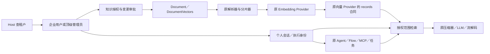

# V1 改动边界

对照基线：AnythingLLM `d7d68e75c422d10384b8aa30f72d6d032fcc555e`。产品只改变用户、租户、知识库和 Workspace 退出后直接受影响的归属、授权及初始化。ERP 业务延期，通用 Agent／Flow／MCP 保留。以实际源码与测试结果为准，不以源码仍在推断功能已经验证。

## 已确认规则

| 对象 | 归属与权限 | 实现边界 |
| --- | --- | --- |
| 租户 | 一个租户对应一个域名；请求 Host 规范化后精确查 `ep_tenants.hostname` | 代理保留外部 Host；未知或停用租户拒绝访问；用户不输入企业代码／域名 |
| 企业用户 | 固定属于一个租户，用户名在企业内唯一；开放注册立即成为普通用户 | 仅 `user/admin` 两种企业角色，无 membership／企业切换；保留头像、简介及密码恢复 |
| 顶级管理员 | 独立初始化账号，全部管理权限，可访问全部企业内容 | 管理操作使用自己的审计身份，不冒充企业用户；企业管理员没有这项越权能力 |
| 知识库 | 独立资源，`createdBy` 仅审计；授权给企业全员为公有，授权给指定用户为私有 | V1 不开放跨企业分享管理，不引入复杂 RBAC |
| 公有知识 | 读取、下载、RAG 按授权直接进行；所有变更须管理员审批 | 包括库、资料、授权变更及重建；候选内容不进入检索，冲突由管理员明确处理 |
| 私有知识 | 获授权用户直接增删改查；企业管理员不自动取得访问权 | 文件与文字、聊天附件保存、同步更新执行相同规则；转为公有须审批 |
| 个人会话 | 属于个人；默认检索当前全部获授权知识库，不绑定知识库 | 沿用原问答 pair、历史、流式回答、引用、编辑／删除／重生成／分叉和 chat/query 语义 |
| 历史快照 | 保留当时回答及其历史引用，不追溯清除已经生成的内容 | 新检索、打开原文和下载重新执行当前权限校验 |
| 模型与配置 | 原全局模型／Embedding 凭据、向量后端、工具定义由顶级管理员维护 | 旧 Workspace 模型选择、提示词和检索参数归租户，V1 同由顶级管理员配置；企业业务工具凭据归企业 |

## 原能力的最小适配

| 原能力 | 新归属／执行边界 | 保留的实现 |
| --- | --- | --- |
| 聊天附件／生成文件 | 个人及会话；明确保存到获授权库，公有库走审批 | 原解析、多模态、渲染和文件格式 |
| 长期记忆 | 企业内个人一层 | 原抽取、合并及提示词注入 |
| Agent／Flow／MCP | 通用定义归平台；企业凭据隔离；按当前用户执行 | 原引擎、工具审批／澄清、流程及 MCP SDK |
| 模型路由 | 规则归平台；企业选择由顶级管理员维护；缓存按用户会话 | 原规则、分类、冷却及供应商实现 |
| Developer API | Key 固定企业和执行用户，由管理员创建 | 原认证协议及可映射的会话／知识能力；不以任意 Workspace 名代替身份 |
| 扩展／移动设备 | 固定企业与个人，权限随执行用户即时变化 | 保留配对、注册与凭据校验；资源查询和采集／聊天合同已变更，现有官方客户端尚未完成兼容验证 |
| 匿名嵌入 | 企业管理员明确发布一个公有库；访客会话独立 | 原 Widget、访问限制与流式交互；企业内公有不自动对外发布 |
| Telegram | 每企业 Bot，企业用户本人绑定，仅私聊 | 原 Bot／Agent 消息流程；运行时校验当前用户和租户状态 |
| 定时任务 | 企业及创建用户；按运行时权限执行；结果个人 | 原任务队列、调度和工具执行；管理员可暂停，用户停用不继续执行 |
| 文档同步 | 固定企业与执行用户 | 原来源抓取和同步任务；私有直接更新，公有形成审批申请 |

`records()` 扩展原向量 Provider 的低层记录合同：显式 namespace、稳定 ID、版本与获授权文档在 topK 前过滤，以及读取／删除记录。它复用原连接、SDK 和分数语义，不负责解析、Embedding 或回答生成。旧 Workspace 的高层索引入口不能原样接回，因为它没有当前授权输入、仍调用旧数据合同。新增业务编排是归属适配的一部分，不能称原完整 Workspace 流程原封不动复用。

AI 请求适配在 `server/enterprise/ai`：将当前配置映射为原 Provider 的环境合同，以异步请求上下文避免并发串用凭据，保留 Provider 工厂、预制选择、SDK、批次、压缩和流解码。业务 PG 存文本、关系和索引元数据，向量本体仍在所选向量后端。

## 数据库与部署

唯一 schema 为 `server/prisma/schema.prisma`，标准 `@prisma/client`，当前 40 张产品表。空库仅部署 `20261022000100_saas_postgres` 一份 PostgreSQL 基线，不维护 SQLite 产品 schema、第二套客户端、旧开发数据导入器或旧 seed。原 `users`、`chat_threads`、`chats` 保持整数自增主键与原生 `DateTime` 字段；个人会话继续按原 `id` 排序，没有新增 `sequence` 排序列。企业用户与线程外键同为整数，顶级管理员及新增租户／知识库／资料标识仍为字符串；混合管理身份的审计字段使用字符串。

原账号、资料、聊天、恢复码及能力表按新归属复用；移除 Workspace 实体与成员关系，不创建隐藏 Workspace。保留 Agent、记忆、路由、API Key、设备、Widget、任务、同步、附件、提示词历史和缓存所需持久化。旧 `ep_users/ep_messages/ep_conversations/ep_tenant_domains` 等重复模型不部署。

初始化幂等创建首位顶级管理员，不生成示例租户、用户或会话。可设置 `INITIAL_ADMIN_USERNAME/PASSWORD`；未设密码时随机生成并保存到持久目录 `initial-admin.json`，日志不输出密码。重启不重置账号。Server 与 Collector 从原 `index.js` 启动；Docker 应用容器包含前端静态资源、Server 和 Collector，连接外部 PostgreSQL；uniapp 单独构建。

向量配置切换不自动搬迁数据，现有索引必须在新连接可访问。当前仅支持并验证单 API 实例的写入协调，本地 LanceDB 使用单写入进程。微信登录使用当前企业域名对应的小程序 AppID 与 AppSecret，通过微信 `jscode2session` 兑换临时 code，首次创建该企业普通用户。AppID／openid 绑定存入原 `users`，企业微信配置加密保存在原 `system_settings`，仅顶级管理员可修改；现已通过模拟微信响应的独立 PostgreSQL 集成测试，真实小程序和 AppSecret 尚未验证，不以构建成功代替微信真机验收。

浏览器扩展当前返回 `libraries`，采集要求 `libraryId`；原官方扩展使用 `workspaces`／`workspaceId`，其无目标的“仅上传”也已变为写入指定知识库。移动设备保留配对入口，但资源命令改为 `conversations`／`conversation-content`，聊天和重置使用 `conversationId`，原官方客户端的 `workspaces`／`workspace-content` 及 `workspaceSlug/threadSlug` 合同未适配。服务端身份与权限测试通过不代表这些官方客户端已兼容；后续需要明确客户端适配或可行的协议映射，不能以隐藏 Workspace 补齐。

## 工作区清理与验证

无需求依据的修改应通过 Git 撤回，不保留在工作区。禁止借 SaaS 改造改写供应商协议、裁剪模型目录、替换解析算法、重做视觉体系、升级 Node 或批量格式化无关代码。移除确认遗弃的 Workspace 链时，先核对活跃调用者，保留仍需要的能力职责。

后端集成测试在显式 `EP_TEST_DATABASE_URL` 的随机独立 schema 中运行；测试覆盖身份、权限、审批、冲突、撤权、索引失败与恢复，并验证原能力的现身份调用。构建、真实模型联调、容器健康与重启验证分别记录。测试日志和覆盖率报告放仓库外，不进入 Git 工作区。未经实际第三方服务验证的连接不能报告为端到端通过。
