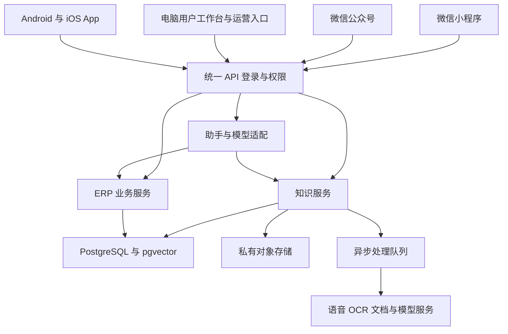

# 多用户知识库与经营 ERP 实施方案

微信小程序 电脑工作台 App 与公众号交付方案

版本 V1.2　日期 2026 年 10 月 15 日

本项目建设多用户、多公众号和多小程序系统，把持续更新的知识库、数量进销存、经营记账和语音助手接入微信、电脑与 App。后台通过渠道接入中心统一授权和适配。本文供负责人、开发与验收人员确定范围、工作量和交付标准。

建议先交付小程序、电脑用户工作台与公众号，再扩展 Android 和 iOS App。各端共用账号、权限和数据。知识通过原文检索回答，库存、欠款和利润由业务数据库计算；语音与图片生成业务草稿，由授权用户核对后入账。

## 1 项目范围与交付目标

### 1.1 已确定的需求

系统支持多用户、公共与私有知识及四种内容输入，知识持续更新并随时查询。适配多个公众号、多个小程序和电脑工作台，扩展 Android 与 iOS App。后台支持一键适配账号与模板；库存按商品规格与数量管理。平台有权查看全部知识，包括私有知识。

### 1.2 首期交付范围

| 模块 | 首期交付 | 后续按需扩展 |
| --- | --- | --- |
| 使用入口 | 小程序 电脑用户工作台 公众号轻入口 | Android 与 iOS App 连续语音通话 |
| 多渠道适配 | 多公众号多小程序授权 模板 一键任务 | 更多模板与外部渠道 |
| 知识管理 | 四种输入 公共企业私有空间 来源与版本 | 网站定时同步 更多外部数据连接 |
| 知识更新 | 去重 冲突提示 纠错 发布与回滚 | 自动专题整理与更多质量评测 |
| 商品库存 | SKU 数量 入出库 退货 盘点 预警 | 多仓调拨 批次效期 多单位换算 |
| 经营记账 | 收付款 应收应付 费用 毛利与报表 | 正式会计总账 发票 税务接口 |
| 智能助手 | 语音提问 图片录单草稿 经营数据查询 | 更复杂的经营分析与工作流 |

### 1.3 推荐默认值

首期每个企业一个账套、一个默认仓库，使用人民币；同一商品不同规格分别建 SKU。成本建议采用移动加权平均法。经营报表先按业务单据总额统计，税额不单独核算。以上为实施默认建议，项目启动时在配置清单中确认。

首期验收以授权可控、库存账目可对账、知识可追溯为核心。第 11 和 15 节给出验收与多渠道适配，第 12 至 14 节给出排期、预算和交付要求。

<!-- page -->

## 2 多用户与知识权限

### 2.1 企业与个人的关系

一个商家或企业对应一个独立业务空间，库存、客户、单据和账目按企业隔离。个人经营者可以创建自己的企业空间，管理自己的 ERP 账套。一个用户可以加入多个企业，两端都必须明确当前企业，助手默认不跨企业汇总数据。

公共知识由平台维护，企业知识供本企业授权成员使用。个人私有知识按企业和所有者隔离，对其他普通用户不可见；平台授权管理员有权跨企业查看全部知识，包括私有原件、解析正文和历史版本，无需逐次取得所有者授权。

提问范围默认是公共知识、当前企业可见知识和本人的私有知识，用户可以切换。只使用已发布或本人已保存的有效内容；公开访客仅能使用公共空间。ERP 业务数据需登录并具备企业权限。

### 2.2 建议角色

| 角色 | 企业知识 | 采购与销售 | 库存 | 资金与利润 |
| --- | --- | --- | --- | --- |
| 老板 | 查询和管理 | 管理全部单据 | 管理 | 查看和管理 |
| 采购 | 按授权查询 | 采购录单与过账 | 按授权查询 | 采购相关应付 |
| 销售 | 按授权查询 | 销售录单与过账 | 可售数量 | 本人或授权应收 |
| 仓管 | 按授权查询 | 查看出入库依据 | 盘点和库存管理 | 默认不可见 |
| 财务 | 按授权查询 | 查看相关业务 | 按授权查询 | 收付款与报表 |
| 普通用户 | 按授权查询 | 默认不可用 | 默认不可用 | 默认不可见 |
| 平台管理员 | 全平台含私有知识 | 按企业另授权 | 按企业另授权 | 按企业另授权 |

角色是权限模板，最终授权还需细分到查询、新建、过账、更正、导出及成本价等字段。首期采购与销售单据合并记录实际收发货；仓管盘点独立授权。复杂的下单、分批收发货和多人交接单据后续扩展。

### 2.3 隔离必须覆盖整个链路

服务端按身份、成员关系和平台角色校验权限，检索先过滤再交给模型。原件、引用、会话、下载、报表与缓存执行相同规则。平台跨企业查看采用专用权限与入口，普通用户不能通过修改企业 ID 获得该能力。

老板身份不自动包含员工私有知识。平台全量查看权由平台管理员角色持有，其他员工按分配权限操作。每次平台检索和查看记录操作者、所属企业、所有者、对象与时间。查看权限不自动包含修改、删除、发布或批量导出，知识也不会因此变为公共。

撤销用户或管理员权限后立即阻止新的检索与访问。离职撤销企业访问，私有知识保持原空间归属与平台查看规则；共享和导出独立授权。私有空间明确提示“对其他用户私有，平台授权管理员可查看”。

<!-- page -->

## 3 页面清单与使用流程

### 3.1 小程序主要页面

| 页面 | 用户能做什么 | 关键结果 |
| --- | --- | --- |
| 登录与工作空间 | 微信登录 选择企业 接受成员邀请 | 明确身份与当前企业 |
| 问助手 | 语音文字提问 选择查询范围 连续追问 | 答案 来源 业务明细 |
| 记知识 | 录音 拍照 输入文字 上传文档 | 解析结果 保存位置 |
| 知识列表与详情 | 搜索 编辑 查看版本 更改授权 | 可管理的知识原件 |
| 商品与库存 | 新建 SKU 查库存 看预警与流水 | 数量 成本 按权限展示 |
| 采购与销售 | 录单 核对 过账 退货 更正 | 单据与库存联动 |
| 客户与供应商 | 管理往来对象 查看欠款和往来 | 业务与收付款关联 |
| 收付款与费用 | 记收款付款 核销欠款 登记费用 | 资金流水与余额 |
| 经营报表 | 查销售 毛利 库存价值 应收应付 | 可展开至原始单据 |
| 我的与成员 | 管理个人设置 成员权限和企业设置 | 权限与操作记录 |

电脑用户工作台面向每位登录用户和企业成员开放，提供自己的知识管理与授权范围内的 ERP 操作，第 3.4 节明确页面与交付要求。平台运营入口负责公共知识维护、租户和运行管理，使用独立权限。

### 3.2 两个录入入口

“记知识”保存经验、制度、资料和笔记；“录业务”保存采购、销售、收付款等单据。两者均支持语音和图片，但保存结果明确区分，避免一句“收到货款”被当成普通笔记。

例如说“向甲供应商采购 A 商品 100 件，每件 10 元，银行已付 800 元”，系统生成待核对草稿，展示商品、数量、单价、供应商、付款账户、已付金额与附件。缺少必填信息或同名商品有多个规格时，先让用户补充或选择。

### 3.3 查询与反馈

问“这件商品怎么保养”，返回知识答案、原文与版本日期。问“A 商品还剩多少，客户乙还欠多少”，返回当前企业数据库结果、查询时点和明细入口。问“本月赚多少”，先明确月份和企业，再按统一利润口径计算。

每条知识回答提供“有帮助”“不准确”“补充知识”。经营数据的异议跳转原始单据核对；助手不能通过修改一段文字直接改变账目。

<!-- page -->

### 3.4 电脑端用户工作台

用户通过浏览器登录，在电脑端管理自己的知识和 ERP。页面顶部固定展示当前企业与登录人，支持切换已加入的企业。个人经营者创建自己的企业空间后，即可管理该空间的商品、库存与账目；企业成员按角色操作。

| 页面 | 用户主要操作 | 权限与数据范围 |
| --- | --- | --- |
| 我的知识与知识问答 | 新建编辑 搜索问答 查看来源和版本 | 本人私有知识与可见知识 |
| 企业与公共知识 | 整理目录 审核发布 归档 回滚 | 按空间与发布权限 |
| 文件与导入任务 | 拖拽上传 批量导入 校对 重试 | 先选目标空间与所有者 |
| 商品与库存 | SKU 管理 期初导入 盘点 流水 预警 | 当前企业 仓库与成本字段权限 |
| 采购销售与往来 | 录单 过账 退货 客户供应商 欠款 | 当前企业与单据操作权限 |
| 资金费用与报表 | 收付款核销 转账 费用 查询导出 | 账户 财务及导出权限 |
| 个人与企业设置 | 个人资料 账号绑定 成员角色 | 个人设置或企业管理权限 |

### 3.5 电脑端交互与双端同步

电脑首期采用小程序扫码确认登录，二维码短时有效、绑定发起浏览器且仅能使用一次。微信内确认后，浏览器取得系统会话，使用安全 Cookie 与 CSRF 防护；退出即撤销会话。企业切换由服务端验证。开放平台网站应用扫码登录可按主体资质另行选择。

桌面布局采用左侧导航、顶部企业切换和右侧操作区。列表支持搜索、筛选、分页、批量导入与导出；详情页能查看原件、版本和关联流水。复杂批量操作先展示校验结果与错误行，再由用户提交。授权导出生成可追踪的下载任务。

电脑与小程序读取同一后台数据。业务过账成功后另一端刷新即可看到；知识处理状态同步显示。两端同时编辑同一草稿时校验版本，旧版本不能覆盖新版本。所有越权操作均由服务端拒绝。

文字、图片与文档在电脑端直接录入；语音支持上传音频，麦克风录音在 HTTPS 下申请浏览器权限。首期验证 Windows 上的 Chrome 和 Edge 主流版本，提供录音不可用时的音频上传入口。

### 3.6 平台运营入口

平台管理员在运营入口维护公共知识、企业账号、用量和任务，并按企业、所有者和时间检索查看全部知识及私有原件。查看全程留痕，下载与导出独立授权。企业业务过账仍按企业角色授权；用户注册时区分“加入企业”和“创建自己的经营空间”。

<!-- page -->

### 3.7 Android 和 iOS App

App 纳入整体产品方案，与小程序、电脑工作台使用同一套账号、权限、知识与 ERP 数据。建议作为第二阶段增量交付，首期接口按多端复用设计；App 的工期和预算在第 12 和 13 节单列。

| 功能区域 | App 提供的能力 | 与现有系统的关系 |
| --- | --- | --- |
| 登录与企业切换 | 登录绑定账号 选择经营空间 | 使用同一系统用户与企业 |
| 语音和拍照录入 | 录音转写 拍照识别 上传文件 | 复用知识与草稿处理服务 |
| 知识管理与问答 | 私有知识维护 搜索 引用 版本 | 保持相同知识权限与发布规则 |
| 数量进销存 | 查库存 采购销售 退货 盘点 | 复用同一业务与成本规则 |
| 记账与报表 | 收付款 应收应付 费用 毛利 | 与电脑及小程序实时账目一致 |
| 通知与任务中心 | 查看解析完成 预警与处理结果 | 按用户授权接收任务与通知 |

### 3.8 App 的技术与交付边界

推荐 Flutter 开发 Android 和 iOS 客户端，共享主要页面与业务代码；录音、相机、文件选择、登录及通知分别做系统适配。已有小程序代码不能直接作为原生 App 发布，服务端接口与业务规则可以复用。

App 登录后绑定现有系统用户；微信授权登录需匹配开放平台移动应用资质，不能假设 App 与小程序的 OpenID 相同。密码和第三方密钥留在服务端，登录凭证放入系统安全存储。

录音、相册和相机在实际使用时申请权限，允许拒绝后继续使用可用入口。首期语音采用点击录音与可选播报；连续实时通话另计。App 消息中心保留结果，系统推送按设备能力和授权适配，不以推送必达作为账务流程前提。

离线可暂存未提交的知识或录单草稿，联网后重新校验版本、权限和库存，再由用户提交。正式过账以在线服务端结果为准；退出、切换企业或撤销账号时处理本地缓存，避免跨账号看到旧数据。

交付包含 Android 安装包、iOS 测试与发布构建、源代码、构建说明及真机报告。上架所需主体、隐私说明、签名与证书归项目方持有；备案、商店审核及开发者账号条件按提交时要求确认。

<!-- page -->

## 4 多模态知识采集

### 4.1 输入格式与首期限制

| 输入 | 处理方式 | 建议首期限制 |
| --- | --- | --- |
| 文字 | 保存正文 自动建议标题和标签 | 单条最多 2 万汉字 |
| 语音 | 录音或导入 转写 保留时间位置 | 单次录音 10 分钟 可分段追加 |
| 图片 | OCR 加图像理解 保留原图 | 单张 10 MB 每次最多 9 张 |
| 文本文档 | 提取章节 表格与页码 建立索引 | PDF DOCX PPTX TXT Markdown |
| 表格和扫描件 | 按工作表或页面解析 必要时 OCR | XLSX PDF 单文件 50 MB 或 200 页 |

这些是应用建议限制，不是对微信所有终端能力的保证。文档及录音导入通过微信会话选文件或电脑工作台完成，具体文件类型在真机上验证。超限内容可拆分或由电脑端批量处理。

### 4.2 处理与保存

用户先选择知识空间，系统保存原件和上传记录，再异步执行转写、OCR、版面解析。图片识别结果一律进入“待人工确认”，原图和草稿仅在受限预览中可见；用户核对并明确确认后才能成为正式知识版本，按空间规则发布并进入正式检索。页面显示“已上传”“解析中”“待人工确认”“待发布”“可查询”或具体失败原因，用户可离开页面后再查看结果。

语音保留原音频及时间片段；图片保留原图，识别文字和模型推断分别标识；文档保留页码、章节、表格位置；XLSX 保留工作表与单元格定位。视觉描述可以辅助检索，但不能把模型推测当成原图事实。

解析生成的标题、标签和摘要可修改。低质量音频、模糊图片、加密文件和损坏文档进入待处理状态，不展示为成功入库。

### 4.3 去重与失败恢复

在同一权限空间内按文件哈希识别重复上传，并提示复用或创建新版本；语义相近内容只提示，不直接删除。后台任务按任务编号去重，失败最多自动重试 3 次，随后进入可人工重试的失败队列。

来源记录至少包含标题、原件位置、录入者、空间、来源日期、创建时间、适用范围和处理状态。知识片段必须能回到所属原件，不能只留下向量而失去原文。

首期文档知识检索以文本和版面提取为主，图片采用 OCR 与视觉描述。复杂图片相似搜索、大型表格计算和公式重算可按实际需求专项增加。

<!-- page -->

## 5 持续更新与知识进化

### 5.1 版本与发布

知识遵循“草稿 → 解析与校对 → 待发布 → 生效 → 被替代或归档”的流程。个人知识由本人保存生效；企业和公共知识由相应维护者发布。资料包含生效日期、有效期、版本和适用对象。

更新只处理发生变化的原件和片段，索引完成后切换生效版本，避免半个文件是新版本、半个文件是旧版本。新版本失败时旧版本继续可用，页面明确显示更新未完成。

同一主题存在新旧规定或相互矛盾的资料时，提示维护者处理。问答默认采用有效版本；证据无法消除冲突时同时展示出处，不由模型自行决定哪条为准。

### 5.2 反馈如何形成更新

系统每天汇总未找到答案的问题、被纠错的回答、过期资料和高频检索需求，为有权限的维护者生成待办。每项待办展示问题、相关原文、建议修改及影响范围。

维护者可以补充资料、修改知识、合并条目、设置有效期或忽略建议。发布前运行与该主题相关的回归问答，发布后记录哪些问题已得到解决。模型回答和用户点踩本身不直接成为正式知识。

### 5.3 自动化的边界

| 动作 | 首期处理 | 操作者 |
| --- | --- | --- |
| 语音转写 标题标签建议 重复检测 | 自动处理并展示结果 | 系统 |
| 保存个人新知识 | 本人保存后可查询 | 知识所有者 |
| 修改企业和公共内容 | 生成建议 按权限发布 | 企业或公共维护者 |
| 私有内容提交公开 | 所有者选定内容再提交 | 所有者与发布人员 |
| ERP 金额 库存和欠款变更 | 草稿核对与业务过账 | 业务授权人员 |
| 外部网站定时更新 | 后续对指定来源启用 | 管理员配置 |

### 5.4 评价是否变好

以固定问答集跟踪“有据回答正确率”“引用有效率”“无资料时的拒答率”和“反馈解决率”，保留版本前后的对比。用户反馈只在有授权的空间内用于改进，不把私有内容混入公共训练或公共知识。

删除和撤回先实时阻断访问，再清理索引、缓存和原件。业务附件按约定保留期限处理；用户主动导出的文件无法由系统远程收回。

<!-- page -->

## 6 商品数量与进销存规则

### 6.1 商品和库存模型

商品字段包括编码、名称、分类、规格、基本单位、条码、参考售价、预警值和启用状态。同名不同规格分别建 SKU。按件的数量使用整数；按千克、米等管理时可为该 SKU 启用小数，首期每个 SKU 只设一个基本单位。

库存按企业、仓库、SKU 记账，并保留数量与成本金额。采购入库增加库存，销售出库减少库存，退货和盘点生成独立流水。期初数量和期初成本通过初始化单据导入并复核。

### 6.2 单据与库存的关系

草稿可编辑且不影响账目；确认过账时检查权限、商品、数量、金额与库存，并在一个数据库事务内生成库存流水和往来记录。已过账单据通过关联更正处理，不覆盖原始记录。

首期采购单记录已收货的采购，销售单记录已交货的销售。默认禁止负库存；同一 SKU 并发出库需加锁校验。盘点按仓库设置截止时点，提交前核对截止后的库存变动，防止盘点期间销售导致数量误差。

### 6.3 移动加权平均成本

每次采购入库，把原库存成本与新增采购成本合并，再除以入库后数量。独立例子：原有 100 件，每件 10 元；再采购 100 件，每件 14 元，则 200 件平均成本为 12 元。之后销售 30 件，结转销售成本 360 元，剩余库存价值为 2040 元。

销售单过账时固定该笔成本，后续进货不会改写历史销售毛利。成本按系统过账顺序计算，另外记录业务发生日期。已关闭期间不能直接补改；确需更正，由有权限人员生成新更正记录并保留原因。

### 6.4 退货与费用

销售退货关联原销售明细，累计退货不得超过原销售数量；按原销售成本恢复库存，退款另行登记。采购退货关联原采购明细，并校验现有库存；原采购价与当前平均成本的差额进入明确的采购退货损益科目，不用负数成本强行平账。

上述差异、盘盈盘亏及无法原样撤销的更正均展示在经营损益明细，默认由财务或老板确认。首期运费作为经营费用登记，后续需要按采购分摊时增加入库费用分摊。

<!-- page -->

## 7 经营记账与报表口径

### 7.1 账目规则

账户包括现金、银行、微信和支付宝等经营账户。采购产生应付，销售产生应收；实际收付款通过核销记录关联业务单据，支持部分和多次结算。首期超出单据未结金额的收付款需更正或另选单据，预收预付独立往来后续扩展。

采购付款只减少资金和应付，销售出库才结转成本。客户回款减少应收，不重复形成销售收入。退货与退款允许不同步，退款挂在对应退货往来项下。费用按发生日期确认，同时记录是否已经支付。

内部账户转账成对登记，转账本金不计收入或费用。老板投入、取款等记录为资金往来，不当作销售收入或经营费用。期初账户、库存、应收应付分别导入，不能凭空凑平。

### 7.2 统一报表公式

净销售额为销售金额减销售退货与折让；销售毛利为净销售额减对应销售成本；经营利润为销售毛利减已确认经营费用，再加减采购退货差异、盘盈盘亏等其他经营损益。资金净流入只按实际资金变动统计。

报表显示企业、日期范围、统计口径与更新时间，并能展开原始单据。首期采用单据金额的管理统计口径，暂不拆分增值税，正式财税报表通过后续会计模块或专业系统处理。

### 7.3 标准对账示例

假设期初资金 2000 元、库存和往来欠款为零，无税额拆分和其他损益。

| 操作 | 库存数量 | 应收 | 应付 | 资金余额 |
| --- | --- | --- | --- | --- |
| 采购 100 件 单价 10 元 付款 800 元 | 100 | 0 | 200 | 1200 |
| 销售 30 件 单价 15 元 收款 300 元 | 70 | 150 | 200 | 1500 |
| 补收客户欠款 150 元 | 70 | 0 | 200 | 1650 |
| 补付采购欠款 200 元 | 70 | 0 | 0 | 1450 |
| 确认并支付经营费用 50 元 | 70 | 0 | 0 | 1400 |

最后净销售额 450 元，销售成本 300 元，毛利 150 元，经营利润 100 元，库存价值 700 元，期间资金净流入为负 600 元。该例必须能在系统中逐步重现。

### 7.4 精度和追溯

金额、数量和成本使用定点数。人民币金额保留到分，单位成本保留更多小数；舍入差额有统一规则和记录。过账保留操作者、业务日期、系统时间、原始附件和关联更正，已过账记录不物理删除。

<!-- page -->

## 8 智能助手与微信接入

### 8.1 三类助手能力

知识查询先做权限过滤，再进行关键词和向量混合检索、重排序及原文回答。结果带来源、页码或录音时间、版本和适用日期。缺少依据时明确提示，必要时让用户补充查询条件。

经营查询调用受限业务接口，库存、欠款、金额及利润由业务服务计算。助手负责理解问题和解释结果，不能根据知识片段估算实时余额。涉及多个企业时先要求明确企业，日期使用北京时间。

业务录入先识别意图和字段，再生成草稿。知识和记账均支持图片识别后人工确认；原图可放大，识别内容和可编辑表单对照展示，不确定项提示补充。知识核对标题、正文和空间；记账核对企业、业务类型、日期、往来对象、金额、账户及适用的商品/SKU、数量、单价等字段。知识点击“确认保存”后按空间规则生效或送审；记账点击“确认入账”后后端重新校验权限、金额、库存和单据状态，在事务内登记。

未确认图片只能保存原件和识别草稿，不进入正式知识索引，不产生库存、应收应付、资金或费用流水；高识别置信度也不能跳过人工确认。可修改、取消、拒绝或重新识别，修改/重识别会生成新版本并使旧确认失效。识别原值、人工最终值、确认人/时间、原图和最终快照完整留痕；后端发布和过账接口验证确认记录，不能只靠前端按钮防护。录音转写和图片内容不能指示系统跳过校验或更改权限。

### 8.2 小程序接入

调用 wx.login 获取临时凭证，服务端换取微信身份并建立系统登录态。录音使用 RecorderManager，图片使用 chooseMedia，文档从会话文件选择或电脑工作台上传。客户端不保存模型密钥、微信 AppSecret 或云服务密钥。

小程序、公众号与系统用户通过服务端验证绑定。同一开放平台满足条件时可使用 UnionID 辅助关联；不能假设不同应用的 OpenID 相同。缺少关联条件时采用登录后的绑定流程。

首期语音交互采用按住或点击录音、转写、查询、文字回答及可选播报。实时连续通话与打断另列扩展，保证首期录音查询流程先稳定可用。

### 8.3 公众号消息处理

微信被动回复需在 5 秒内完成，否则会重试。回调收到消息后先验证签名、校验格式并按消息编号去重，再快速应答；复杂任务进入队列，结果在小程序任务与会话中查看。不得在回调请求中一直等待大模型回答。

账户具备相应客服或通知权限，且满足发送窗口或订阅条件时，可追加结果通知；否则保留小程序结果入口，不把任意主动消息作为必需能力。简单消息可直接回复，文件管理和正式业务确认在小程序完成。

公众号接入范围以现有账号类型、认证和接口权限为准。首次交付至少完成菜单入口、账号绑定和允许范围内的文字语音图片消息处理。

<!-- page -->

## 9 系统架构与技术选型

### 9.1 推荐结构

### 9.2 首期技术栈

| 层级 | 建议选择 | 用途 |
| --- | --- | --- |
| 微信前端 | 原生小程序 TypeScript 统一模板 | 多 AppID 配置与版本发布 |
| 电脑工作台 | Next.js TypeScript | 用户知识 完整 ERP 运营权限入口 |
| App 增量 | Flutter Android 与 iOS | 复用 API 与数据 移动端适配 |
| 业务后端 | FastAPI 模块化单体 | 权限 知识 ERP 助手工具 |
| 数据与检索 | PostgreSQL pgvector 中文关键词检索 | 事务 业务统计 知识召回 |
| 异步任务 | Celery Redis 数据库事件表 | 转写 解析 索引 重试 |
| 文件与模型 | 私有 COS 模型统一适配层 | 原件保存 语音 OCR 与生成 |

各端共用业务后端，渠道适配层按 AppID 处理身份、消息、授权和模板配置。后台采用模块化单体，平台运营功能独立授权；搜索引擎、服务拆分或专用向量库依据压测结果增加。

### 9.3 模型与文件处理

国内可用模型服务作为首期候选，分别评测文本生成、图像理解、转写、嵌入和重排序。根据真实中文资料的效果、稳定性、数据处理条款及费用选择供应商。文档解析优先使用许可适配的现成组件，复杂扫描件按需采用 OCR。

保留服务替换接口，数据库和文件归项目方。模型不可用时，已有 ERP 业务仍可手工操作，知识保留原文搜索入口。研发预览环境和生产环境的数据、密钥与对象存储分别配置。

<!-- page -->

## 10 开发接口与数据一致性

### 10.1 核心数据对象

用户域包含企业、用户、微信身份、成员和角色。知识域包含空间、原件、版本、片段、任务、反馈和发布。业务域包含商品、仓库、库存流水、单据、往来、账户、核销和费用。渠道域包含账号授权、企业绑定、模板、部署任务与发布记录；公共能力包含会话、审计和事件。

企业数据带企业标识，私有记录再带所有者；渠道身份以 AppID 与 OpenID 联合唯一。平台全量知识查看独立授权和审计。金额使用 decimal，日期与过账时间分开，单据号在企业内唯一；所有请求逐次检查权限。

### 10.2 首期接口边界

| 接口 | 作用 | 关键约束 |
| --- | --- | --- |
| POST /v1/sessions/wechat | 小程序登录换系统会话 | 服务端验证临时凭证 |
| POST /v1/desktop-logins | 创建电脑扫码登录任务 | 短时有效 一次性凭证 |
| POST /v1/uploads | 申请上传或提交附件 | 校验空间 格式与大小 |
| POST /v1/sources | 新增知识来源 | 返回异步任务编号 |
| GET /v1/ingestions/{id} | 查看解析状态 | 仅授权用户可见 |
| POST /v1/queries | 查询知识与业务 | 权限范围由后端决定 |
| POST /v1/feedback | 纠错与补充建议 | 保存关联答案与来源 |
| POST /v1/publications | 发布或恢复知识版本 | 校验发布权限与版本 |
| POST /v1/documents | 创建业务草稿 | 类型明确 字段可校验 |
| POST /v1/postings | 单据过账或关联更正 | 事务与幂等 版本校验 |
| POST /v1/payments | 收付款及单据核销 | 校验账户与未结金额 |
| GET /v1/reports/{type} | 经营统计与明细 | 授权字段 统一口径 |
| POST /v1/wechat/events | 微信消息回调 | 验签 解密 去重 快速应答 |

### 10.3 必须实现的约束

过账和收付款请求携带幂等编号、草稿 ID 和预期版本。同一编号重复请求返回原结果；同编号不同内容返回冲突。库存、欠款和资金在事务中一并更新，失败则整体回滚。索引更新通过事件表可靠投递到队列。

图片来源草稿还必须绑定当前版本的人工确认快照。“确认入账”可以在一个事务内完成确认和过账；仅“保存草稿”不入账。缺少确认记录或快照不一致必须拒绝。同票据不同照片按当前企业、单号、往来对象、日期和金额提示疑似重复，不能只靠文件 hash；实际付款/到账状态不能仅由图片推断。

接口统一使用结构化错误，包含 code、message、requestId；权限不足返回 403，版本或库存冲突返回 409，输入问题返回 422。列表分页，查询参数定义上限；接口入参、返回字段与错误示例随 OpenAPI 一起交付。

<!-- page -->

## 11 验收标准与质量验证

### 11.1 必测业务与权限案例

| 编号 | 验收场景 | 通过标准 |
| --- | --- | --- |
| A01 | 四种知识输入 | 可查询且能返回原件位置 失败可重试 |
| A02 | 用户隔离与平台查看 | 用户越权拒绝 平台可查全部知识并留痕 |
| A03 | 知识更新与回滚 | 仅完整生效版本参与查询 历史可追溯 |
| A04 | 知识与记账图片人工确认 | 原图与识别结果对照可改；未确认不入库/入账；同名规格需选择；取消/拒绝无流水；旧确认不能复用 |
| A05 | 标准记账示例 | 第 7 节每一步数量 欠款与资金完全一致 |
| A06 | 加权成本与退货 | 第 6 节成本正确 退货上限与差异可对账 |
| A07 | 库存并发 | 5 件库存同时售两笔各 4 件 最多一笔成功 |
| A08 | 重复请求 | 同一请求重复提交 只记一次库存与账目 |
| A09 | 收付款与更正 | 部分核销 退款 转账不重复影响利润 |
| A10 | 数据恢复 | 从备份恢复后 单据 库存 欠款与附件可对齐 |
| A11 | 微信真机 | 安卓与 iOS 登录 录音 选图 文件与弱网可用 |
| A12 | 公众号超时与重试 | 回调快速完成 重放消息不重复生成业务 |
| A13 | 每位用户的电脑工作台 | 可管理本人知识与授权 ERP 批量导入导出 |
| A14 | 双端一致与电脑登录 | 两端同数 冲突不覆盖 扫码凭证不可复用 |

### 11.2 知识与模型评测

使用项目方提供并人工标注的 100 个问题，其中 70 个有明确答案、20 个无资料、10 个包含冲突或过期资料。有依据的回答与冲突处理正确率目标不低于 90%；引用有效率不低于 95%；无资料时正确拒答至少 19 个。自动打分只能辅助，最终由业务人员核对。

经营查询另设固定数据库案例，金额、数量和欠款必须完全符合业务计算。成本价不可见的角色，即使诱导助手或上传恶意文档也不能获得该字段。

### 11.3 建议运行目标

首期压测基线为 100 个企业、1000 个注册用户、10 万个有效知识片段、20 路同时问答请求和 50 个并发业务会话；这些是估算与验收基线，不代表已实测能力。

不计网络上传耗时，普通业务接口 P95 目标不超过 1.5 秒；常见知识问答完整回复 P95 不超过 15 秒，超时展示任务状态并允许重试；发布完成后索引目标 2 分钟内生效。供应商超时和复杂文件另计并记录。

提测必须提交权限、事务、计算、幂等、失败恢复及真机报告。已知缺陷按影响评级，库存账目错误与数据越权问题未解决不得上线。

<!-- page -->

## 12 实施排期与人员分工

### 12.1 十六周实施计划

| 时间 | 工作内容 | 阶段成果 |
| --- | --- | --- |
| 第 1 至 2 周 | 双端原型 权限账务 多账号与第三方平台准备 | 详细需求 页面 数据和渠道设计 |
| 第 3 至 5 周 | 多账号登录 四种知识输入 检索与引用 | 双端知识管理 平台查看与审计 |
| 第 6 至 9 周 | SKU 期初 采购销售 库存成本 | 双端可操作的数量进销存 |
| 第 10 至 11 周 | 收付款 费用 退货 报表 导入导出 | 完整经营闭环 |
| 第 12 至 13 周 | 助手 渠道模板 一键部署 公众号适配 | 多账号授权与发布任务联调 |
| 第 14 至 16 周 | 测试 压测 初始化 培训与试运行 | 多账号验收 可发布版本 运维交接 |

首期包含电脑工作台、多公众号多小程序与一键适配，约 155 人日：后端 60、电脑前端与小程序 50、测试 30、产品 10、运维 5。较基础双端方案增加约 40 人日渠道能力。建议两名主要开发人员，产品、测试和运维分阶段参与。

微信主体认证、备案、平台审核、第三方采购及等待资料的时间不计入软件开发工期，尽早与第 1 周工作并行启动。模型效果不达标或业务范围增加时重新估算相关任务。

### 12.2 三个交付里程碑

第 5 周检查双端知识、账号隔离与平台查看；第 11 周重现采购销售及记账案例；第 16 周完成多账号一键适配验收与试运行。各阶段交付可演示的软件和测试结果。

项目方负责业务样本、期初数据、知识内容、账号主体与验收。开发方负责软件、数据迁移工具、测试、部署和文档。知识维护者负责企业与公共知识发布；财务或经营负责人确认成本、费用、退货和期初口径。

### 12.3 首次试运行

先选择一个真实企业和少量授权人员，使用脱敏样本练习，再导入复核后的期初数据。试运行 1 至 2 周，每天核对库存、资金与欠款；达到验收目标后逐步放开用户。原有记账方式在核对期间保留，避免切换时缺少对照。

### 12.4 App 增量排期

App 建议在首期接口稳定后实施，约增加 40 人日、6 至 8 周；按顺序推进，整体软件历时约 22 至 24 周。App 开发、后端适配和测试可由独立人员并行推进，需重新核定人员与依赖。各平台认证、备案与审核等待时间另计。

<!-- page -->

## 13 建设预算与运行费用

### 13.1 开发预算的计算口径

以下为项目规划估算，均为人民币，不是供应商报价。按 155 人日、综合日成本 1200 至 1800 元计算，首期软件约 18.6 万至 27.9 万元；增加 15% 预备金，建议预留约 21.4 万至 32.1 万元。

首期包含电脑知识与 ERP 工作台、多公众号多小程序、平台运营入口、一套标准模板、一键适配、测试和部署。App 按第 13.4 节单列；认证、硬件、税费、正式财税模块、数据清洗和持续运营另计。

### 13.2 每月运行费用示例

估算负载为每月 1.5 万次问答、6000 分钟转写、5000 页 OCR、1000 分钟播报和约 100 GB 原件。下表单价范围仅用于预算分配，正式采购按选定供应商、模型 token、调用套餐和地域计算。

| 项目 | 预算计算方式 | 每月估算 |
| --- | --- | --- |
| 应用 数据库 缓存 备份监控 | 初期固定资源 | 800 至 2200 元 |
| 文件与网络 | 原件 备份和下载流量 | 100 至 300 元 |
| 模型与检索调用 | 1.5 万次乘每次 0.03 至 0.10 元 | 450 至 1500 元 |
| 语音转写 | 6000 分钟乘 0.02 至 0.06 元 | 120 至 360 元 |
| OCR | 5000 页乘 0.02 至 0.10 元 | 100 至 500 元 |
| 语音播报 | 1000 分钟乘 0.02 至 0.10 元 | 20 至 100 元 |
| 合计 | 初期预算区间 | 1590 至 4960 元 |

可按每月约 1600 至 5000 元预留运行费用。语音供应商可能按字符、时长或套餐计费，表中统一折算作预算参考。公开图片大量访问、高规格数据库、长上下文和专业文档解析会增加成本；不含持续研发和人工运维服务费。

### 13.3 成本控制

按企业统计模型、转写、OCR 与文件用量，设置月度预算提醒和任务额度。文档只处理变化部分；检索先缩小范围再调用模型；转写与 OCR 结果可复用，但缓存必须包含企业、用户、权限和知识版本。

上线前用实际资料跑一轮调用账单和压测。若需要数据库高可用、跨地域恢复或更高并发，单独列出资源档位与费用，不用初期预算承诺更高服务等级。

<!-- page -->

### 13.4 App 增量预算与总量

Android 和 iOS 采用同一 Flutter 工程，共用现有知识与 ERP 服务。按约 40 人日估算，沿用综合日成本 1200 至 1800 元；未包含连续语音通话、完整离线记账或专门定制的硬件能力。

| 项目 | 工作量依据 | 软件估算 |
| --- | --- | --- |
| App 页面与系统适配 | 25 人日 | 3 万至 4.5 万元 |
| 登录与后端适配 | 5 人日 | 0.6 万至 0.9 万元 |
| 真机测试 构建与发布准备 | 10 人日 | 1.2 万至 1.8 万元 |
| App 基础合计 | 40 人日 | 4.8 万至 7.2 万元 |
| App 含 15% 预备金 | 基础合计乘 1.15 | 5.52 万至 8.28 万元 |
| 首期加 App 含预备金 | 共 195 人日 | 约 26.9 万至 40.4 万元 |

开发者账号、平台认证、上架服务、所需 Mac 设备、短信和商业推送等费用按选用方式另计。App 不重复建设一套数据库；新增模型、转写和存储费用按所有入口的实际总用量计算。

### 13.5 多账号与模板的计价边界

首期包含一套标准产品模板，适配多公众号与多小程序，验收至少覆盖 2 个公众号和 2 个小程序，分别连接 2 个测试企业。新增账号复用已交付模板时，通过后台授权和配置接入。

不同账号可配置名称、Logo、主题色、菜单、模块开关、默认知识空间和关联企业。涉及新页面、新业务流程、独立支付商户或特殊权限能力时，单独评估；模板参数不能改变后台权限和过账规则。

渠道配置本身不按账号数复制数据库资源。运行预算按总用户、问答、文件、任务和接口配额核算；大量账号的发布队列、日志和独立品牌模板按实际规模调整。

<!-- page -->

## 14 上线与交付清单

### 14.1 上线准备

项目方准备微信主体、第三方平台、多账号授权、备案域名、企业资料与云账号。HTTPS、录音相册和文件用途按平台要求配置；注册协议及私有空间明确告知平台管理员可查看私有知识，并保存告知版本。

上线前完成期初对账、双端角色实测、扫码登录与退出、密钥配置、文件访问验证和备份恢复演练。数据库建议开启连续备份，恢复点目标 15 分钟以内、恢复时间目标 4 小时以内；需通过采购和演练验证。

发布使用版本化镜像与数据库迁移。出现故障时优先停用模型或新录单入口，保留只读和对账能力。应用回退不能覆盖上线后的业务流水；数据库恢复涉及已发生业务时，按恢复方案校对并补录。

### 14.2 开发方必须交付

交付电脑工作台与运营地址、小程序标准模板、渠道授权及一键适配手册、源代码与镜像、数据字典与迁移、OpenAPI、验收报告、导入模板、备份恢复和权限说明。App 阶段追加安装包、iOS 构建和真机报告。

生产账号、域名、源代码仓库、数据库和原文件由项目方持有。建议合同约定验收后 30 天缺陷修复期；新功能、第三方调价和持续内容维护另行约定。

### 14.3 开发前确认清单

| 事项 | 推荐起点 | 确认人 |
| --- | --- | --- |
| 商品规格与单位 | SKU 加数量 单基本单位 | 经营负责人 |
| 成本与金额口径 | 移动加权 管理统计暂不拆税 | 财务或经营负责人 |
| 知识查看与发布权限 | 私有本人及平台可查 发布另授权 | 项目负责人 |
| 多账号与 App 范围 | 一套标准模板 App 分阶段交付 | 项目负责人 |
| 账号与使用规模 | 实际微信主体与首期企业用户 | 项目负责人 |
| 资料与期初数据 | 样本文档 商品 库存 欠款 资金 | 业务负责人 |

### 14.4 微信官方实施依据

接口核验日期为 2026 年 10 月 15 日。详细配额、权限与审核要求以接入时官方文档和账号后台为准。

- [小程序登录流程](https://developers.weixin.qq.com/miniprogram/dev/framework/open-ability/login.html)
- [小程序录音管理](https://developers.weixin.qq.com/miniprogram/dev/api/media/recorder/wx.getRecorderManager.html)
- [图片拍摄与选择](https://developers.weixin.qq.com/miniprogram/dev/api/media/video/wx.chooseMedia.html)
- [从微信会话选择文件](https://developers.weixin.qq.com/miniprogram/dev/api/media/image/wx.chooseMessageFile.html)
- [小程序网络域名与 HTTPS](https://developers.weixin.qq.com/miniprogram/dev/framework/ability/network.html)
- [公众号被动回复与超时重试](https://developers.weixin.qq.com/doc/offiaccount/Message_Management/Passive_user_reply_message.html)

<!-- page -->

## 15 多公众号与多小程序一键适配

### 15.1 渠道与企业的对应关系

每个公众号和小程序都是独立渠道，以 AppID 唯一标识。首期每个商家渠道绑定一个企业，一个企业可绑定多个渠道，共用该企业知识与 ERP。将渠道转给其他企业时须由平台管理员处理，保留变更记录，不能自动搬迁原企业数据。

用户身份以系统用户 ID 为准，微信身份以 AppID 和 OpenID 共同标识。跨账号绑定需用户验证；符合条件时可辅助使用 UnionID。关注公众号、扫码或授权登录不自动授予 ERP 权限，仍需验证企业成员关系。

平台的全量知识查看权通过管理员入口使用，商家渠道与普通助手始终按当前用户过滤知识。渠道绑定企业不代表该渠道所有用户都能看到企业成员的私有内容。一个共享 App 支持选择企业，独立品牌 App 可另行规划。

### 15.2 推荐接入方式

长期采用微信开放平台的平台型第三方平台，让各公众号或小程序管理员扫码授权，平台保存授权方身份、权限集和令牌。先申请需要的权限集并完成第三方平台配置，未全网发布时使用官方授权测试账号联调。

少量自有账号可使用自建应用接入，通过后台配置 AppID、密钥、回调与域名；其代码上传等自动化依赖开发工具接口和凭证。首期一键模板发布以第三方平台授权模式作为标准交付路径，两种方式在同一渠道列表中标明。

公众号主要适配菜单、自动回复、消息路由与小程序入口；小程序主要适配品牌配置、代码模板、域名、体验版、提审及发布。二者按账号实际权限工作，缺少权限时显示待补充项和处理入口。

### 15.3 渠道接入中心与一键任务

| 后台能力 | 管理员操作 | 系统结果 |
| --- | --- | --- |
| 新增渠道 | 选择账号类型 扫码授权 关联企业 | 保存 AppID 权限集与授权状态 |
| 套用模板 | 选择版本与品牌配置 模块知识范围 | 生成配置快照与差异预览 |
| 一键适配 | 核对目标账号并启动任务 | 检查授权 域名 消息和模板配置 |
| 小程序发布 | 生成体验版 确认提审 发布 | 保存审核编号 状态与发布结果 |
| 公众号配置 | 预览菜单 回复和小程序入口 | 在权限允许范围内下发并校验 |
| 批量升级 | 选择账号批次与目标版本 | 限速执行 逐账号记录 可单独重试 |
| 诊断与停用 | 查看错误 重新授权 暂停接入 | 定位权限问题 停止受影响任务 |

“一键适配”指授权和资料齐备后，从统一后台自动执行可用接口，并展示每一步结果。认证、备案、账号主体操作、微信审核和必须由账号管理员完成的授权仍按官方流程办理。系统不能把“上传代码成功”显示为“已经上线”。

<!-- page -->

### 15.4 发布任务与失败恢复

流程为“选择渠道和模板 → 校验权限与配置 → 生成适配快照 → 应用配置或上传代码 → 体验验证 → 提交审核 → 等待结果 → 按管理员选择发布”。公众号直接显示配置结果，小程序分别展示体验版、审核版与线上版。

任务按企业、AppID、模板和幂等编号记录；同一渠道串行，跨渠道按配额并行。失败独立处理，保存错误码和失败步骤，重试前查询官方状态，防止重复提审或发布。

先测试单个渠道，再分批发布。配置可恢复前一快照，代码回退按微信能力执行，必要时重提旧模板。数据库保持兼容，回退不撤销已发生的库存和资金流水。

### 15.5 授权与消息的隔离

各渠道独立加密保存令牌，刷新加锁，日志脱敏，并接收授权变更通知。撤销授权后停止代调用及待发布任务，企业数据继续由其他有效入口访问。

回调验签解密后按接收方 AppID 路由，以 AppID、消息类型与编号或事件特征去重。企业归属由服务端绑定关系确定，客户端参数不能改变归属。

服务域名优先按第三方平台模板模式配置，上线前查询生效结果并比对原域名，避免覆盖原业务。模板的企业编号和模块开关用于界面，业务服务始终验证真实授权。

### 15.6 多渠道与 App 的追加验收

| 编号 | 场景 | 通过标准 |
| --- | --- | --- |
| C01 | 2 个公众号加 2 个小程序 | 复用一套模板 无需分别改业务代码 |
| C02 | 两企业与多渠道数据 | 同企业同步 跨企业隔离 绑定需验证 |
| C03 | 账号权限不足或撤销 | 明确缺项 停止代调用和未完成任务 |
| C04 | 批量发布与失败重试 | 逐账号独立状态 重试不重复发布 |
| C05 | 平台查看私有知识 | 可查看原件和版本 操作有审计记录 |
| C06 | 模板升级与域名 | 参数可配置 原渠道正常 域名无误删 |
| C07 | App 真机与多端同步 | 两系统采集查询 ERP 同数 权限一致 |
| C08 | App 断网与重复提交 | 草稿可恢复 重连再校验 不重复入账 |

C01 至 C06 纳入首期验收，C07 与 C08 在 App 阶段验收。商家提供有效账号及对应权限；测试需覆盖同一企业多渠道、不同企业、同一用户跨渠道绑定和管理员权限撤销。

### 15.7 微信第三方平台官方依据

- [账号扫码授权与权限集](https://developers.weixin.qq.com/doc/oplatform/Third-party_Platforms/2.0/api/Before_Develop/Authorization_Process_Technical_Description.html)
- [模板代码上传与体验版](https://developers.weixin.qq.com/doc/oplatform/Third-party_Platforms/2.0/api/code/commit.html)
- [小程序提交审核](https://developers.weixin.qq.com/doc/oplatform/Third-party_Platforms/2.0/api/code/submit_audit.html)
- [发布已经审核通过的版本](https://developers.weixin.qq.com/doc/oplatform/Third-party_Platforms/2.0/api/code/release.html)
- [代开发小程序域名配置](https://developers.weixin.qq.com/doc/oplatform/Third-party_Platforms/2.0/product/domain.html)
