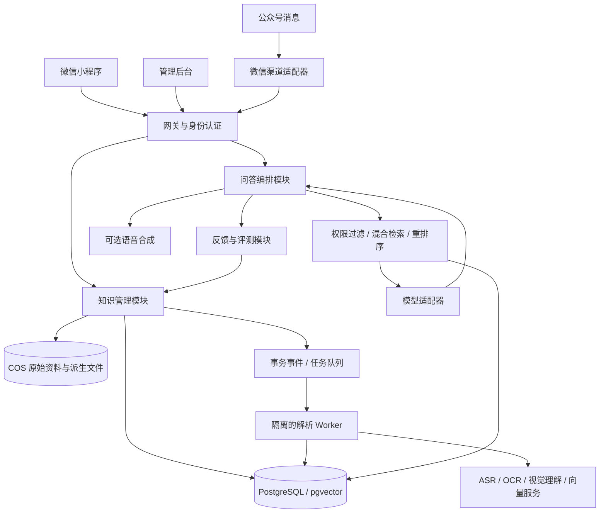

# 微信多模态知识库完整技术方案

> 2026-10-15 实施更新：用户决定先做知识库，ERP 和 App 延后，并优先整合成熟开源源码。当前实施基线见 [开源整合说明](open-source-integration.md)、[ADR-002](decisions/knowledge-platform-002.md) 和 [任务计划](../tasks/plan.md)。本文的业务需求与验收边界继续作为参考，其中自研技术栈、工程目录和工期不再直接作为当前执行计划。

版本：1.1（技术设计稿；补充图片人工确认要求）  
日期：2026-10-15  
状态：用于需求评审、开发估算和实施交接；尚未开发、压测或上线。  
范围：持续更新的知识库、语音/图片/文字/文档录入、随时查询、微信公众号与小程序。现有目录中的其他业务方案不自动纳入本项目。

本次明确增加知识与记账共用的图片识别人工确认协议；完整记账/库存业务规则沿用《多用户知识库与ERP实施方案》，此处只补充识别、确认和交接边界。

## 1. 推荐结论

建设“微信小程序 + 管理后台 + 统一知识服务 + 持续改进中心”。小程序承担完整采集与查询；公众号承担轻量问答、菜单入口及平台规则允许的通知；电脑后台承担批量导入、原文核对、审核发布、权限和运营管理。

首期采用模块化单体 API、独立异步 Worker、PostgreSQL + pgvector、Redis 和对象存储。语音识别、OCR、大模型及语音合成调用国内托管 API，通过适配层替换厂商。先把知识治理和检索质量做对，再考虑微服务、独立搜索集群或模型微调。

“持续更新”是新资料解析与索引更新；“持续进化”是反馈驱动的知识修订和检索优化，并由评测证明改进。普通对话不直接改变模型参数。

## 2. 需求、假设与规模基线

### 2.1 已明确需求

- 语音、图片、文字、文档四种知识输入。
- 每天追加、纠正和更新知识；历史可追溯。
- 文字或语音随时查询，答案能解释依据。
- 通过微信公众号或微信小程序使用。
- 系统能利用反馈持续改善。
- 知识和记账都支持图片识别，识别完成后必须人工核对确认；识别成功不能代替确认。

### 2.2 为技术估算采用的默认值

| 项目 | 默认设计值 | 说明 |
|---|---|---|
| 用户关系 | 平台—组织—成员—知识空间 | 初期可只有一个组织，预留多组织隔离 |
| 知识空间 | 私有、团队、公开 | 是推荐设计，是否全部首期开启由业务决定 |
| 投稿 | 授权成员可录入；公众投稿默认关闭 | 普通查询不会变成知识 |
| 发布 | 私有库所有者确认；团队/公开库审核发布 | 个人可以一人兼任编辑和审核 |
| 使用语言 | 中文普通话为主，保留英文术语 | 方言与行业术语另做识别评测 |
| 初始数据 | 1 万份来源，约 10 万片段 | 片段量取决于长度，不按文件数推算性能 |
| 月活/问答 | 1,000 月活，日均 1,000 次查询 | 约 3 万次/月，仅用于容量和预算估算 |
| 并发 | 20 个活跃查询；另控模型并发 | API 并发不等于模型并发配额 |
| 实时程度 | 一般资料在解析完成并发布后 5 分钟内可查 | 长录音/大文档单独按处理进度计时 |
| 首期入口 | 小程序、管理后台、一个服务号 | Android/iOS 独立 App、支付订阅不在首期 |

这些数值是目标和容量假设，不是已验证性能。行业、账号资质、数据敏感等级及实际流量确定后重新估算。

## 3. 用户体验与页面清单

### 3.1 小程序

| 页面 | 核心操作 |
|---|---|
| 问助手 | 输入文字、按住说话、可选附图辅助提问；展示检索/生成进度 |
| 回答详情 | 简明答案、引用出处、资料更新时间、播放语音、纠错、反馈 |
| 记知识 | 选择空间与录入类型；明确“保存知识”用途 |
| 录入预览 | 原图与识别结果对照；可修改、重新识别、取消；知识“确认保存”，记账“确认入账”分别标明结果 |
| 我的资料 | 查看解析状态、草稿、发布状态、历史版本、失败重试 |
| 知识空间 | 切换私有、团队和公开空间；按权限浏览 |
| 我的 | 登录、授权、用量、导出/删除申请、反馈 |

首期语音采取“按住说—松开发送—转写确认—查询”。不做一直监听、锁屏唤醒或双向实时打断；这些需要额外的实时音频架构和平台实测。

### 3.2 管理后台

包含批量上传、资料列表、原文与解析预览、标签分类、版本比较、审核队列、发布撤回、成员角色、知识授权、反馈工单、未命中问题聚类、评测报告、调用用量和审计记录。

### 3.3 四个典型流程

1. 管理员口述一条经验 → 系统生成转写和知识草稿 → 核对 → 发布 → 用户可检索。
2. 上传新制度文件 → 与旧制度比对 → 标出冲突 → 管理员指定生效时间和替代关系 → 新版本生效。
3. 用户语音提问 → 确认识别文字 → 搜索有权访问的知识 → 返回答案、出处及可选语音。
4. 用户指出错误 → 建立反馈工单 → 编辑修订知识草稿 → 评测 → 审核发布 → 原问题重测。

## 4. 架构与模块边界



主要模块：identity、spaces、uploads、ingestion、knowledge、publication、retrieval、chat、feedback、evaluation、wechat、metering、audit。业务规则保持在模块内，通过显式服务接口调用；API 和 Worker 可共享业务包，但独立部署、限额和扩缩容。

原始资料与权限、知识版本属于自己的业务系统。模型服务只负责识别或生成，不能直接决定数据访问范围、修改权限或发布知识。

## 5. 技术栈及取舍

| 层 | 推荐 | 选择原因与约束 |
|---|---|---|
| 小程序 | 原生小程序 + TypeScript + TDesign 小程序组件 | 贴合微信录音、文件、登录能力；避免首期多端兼容成本 |
| 管理后台 | React + TypeScript + Vite + Ant Design | 以资料管理和审核表单为主，无需首期服务端渲染 |
| 业务 API | Python FastAPI + Pydantic + SQLAlchemy + Alembic | 方便接文档处理与 AI SDK；生成 OpenAPI 合同 |
| 异步任务 | Celery + Redis；PostgreSQL 保存任务事实和 outbox | Redis 不作为任务唯一存档，避免消息丢失无人追踪 |
| 业务/向量库 | PostgreSQL + pgvector | 事务、权限关系、版本和向量可同库管理 |
| 中文关键词检索 | 首期分词后写入 tsvector，配型号/编号精确索引 | PostgreSQL 默认英文分词不能直接当中文全文检索 |
| 文件 | 腾讯云 COS 私有桶 | 原件与派生文件分目录；短时签名访问 |
| 模型 | 国内商用托管模型，至少评测两个候选 | 选定中文问答主模型与备用模型；模型精确版本上线时锁定 |
| ASR/OCR/TTS | 首选腾讯云同地域服务；均封装适配器 | 采购前核对支持格式、地域、额度、单价和数据条款 |
| 文档 | pypdf、python-docx、python-pptx、openpyxl + 托管 OCR | 数字文档优先直接抽取；扫描和复杂版面采用 OCR |
| 部署 | Docker + CI 构建；生产使用托管数据库与容器/云主机 | 首期不要求 Kubernetes，不自建 GPU 集群 |
| 观测 | OpenTelemetry + 云日志/指标服务 | 串联上传、解析、检索、生成、反馈并计量成本 |

所有依赖锁定版本和镜像摘要；实施时复核维护状态与许可证。复杂 PDF 可评测 Docling/MinerU 等替代方案，但代码、模型权重及商用部署条款分别审核，不能直接假设全部免费商用。

Dify、扣子或 RAGFlow 可用于早期原型或替代部分编排；正式版的身份、权限、版本、原件、审计必须由自有业务服务控制。若使用这些平台，应把项目空间隔离与检索权限作为上线前验证项，不能只靠提示词限制。

## 6. 四种输入的处理链路

### 6.1 通用链路

申请上传 → 私有对象存储 → 服务端核验对象大小、魔数及摘要 → 安全扫描 → 创建来源/草稿版本 → 入队解析 → 标准化 → 去重/冲突检测 → 编辑核对 → 索引就绪 → 发布。

每次上传保留 sourceId、revisionId、contentHash、文件类型、所有者、目标空间、来源渠道、上传时间、解析器版本、处理状态。模型生成的摘要与原文分开保存，不能把摘要当作唯一证据。

| 输入 | 首期应用限制建议 | 处理方式 | 定位信息 |
|---|---|---|---|
| 语音 | 提问单段 60 秒；知识录入单段 10 分钟；导入录音 60 分钟/100MB | 转码、分段 ASR、术语纠正候选、人工确认 | 起止毫秒、发言片段；说话人分离为可选 |
| 图片 | JPG/PNG/WebP；每张 10MB、每批 9 张 | 旋转校正、OCR；必要时视觉模型解释图表 | 图号、坐标框、原图引用 |
| 文字 | 单次 2 万汉字；更长转文件导入 | 结构清洗、标题/标签建议、冲突检测 | 标题路径、段落位置 |
| 文档 | PDF/DOCX/PPTX/XLSX/TXT/MD；单份 50MB，PDF 300 页 | 按页/标题/表格解析；扫描件 OCR | 页码、幻灯片号、表格/工作表/单元格范围 |

以上是应用自定义起步限制，不是微信或厂商保证。实测设备内存、网络和供应商接口后确定最终值；超长录音优先电脑上传，移动录音按段保存并支持中断恢复。

### 6.2 语音

- 保留原音频及原始转写；人工校对另建修订层。
- 提问转写暂不进入知识库；保存为知识需明确操作。
- 人名、型号、金额、日期和专业术语重点标记；不确定词可提示用户确认。
- ASR 低质量内容进入人工核对，不直接公开发布；没有置信度字段时使用可解释的质量规则，不能伪造分数。

### 6.3 图片

- 文字截图、合同照片和票据主要走 OCR；图表和结构示意图按需调用视觉模型。
- 自动描述标明为 AI 提取，来源仍是原图；不把模糊图片里的猜测写成事实。
- 首期检索图片的 OCR 和确认后描述，同时展示原图；“无字图片找相似图”属于二期视觉向量检索。
- “拍张图直接提问”与“把图存为长期知识”分开；提问附件只在本次会话的授权范围内使用。
- 图片长期知识必须先人工确认，再按空间规则保存/审核发布。高识别置信度也不能跳过确认；待确认内容不能进入正式问答索引。

### 6.4 文档

- PDF 优先抽取文字和页码，对扫描页再 OCR；重复页眉页脚清理时保留定位映射。
- Word 保留标题层级和表格；PPT 保留幻灯片顺序；Excel 保留工作表与表头关系。
- Excel 中的经营金额、库存和汇总不靠语言模型自由计算；有精确计算需求时使用确定性计算服务，并显示筛选条件和数据日期。
- .doc/.xls/.ppt 等旧格式先在隔离环境转换，或提示转成新格式；不执行宏、脚本、外链和嵌入程序。
- 加密文件要求用户先解除密码；损坏、空白、乱码文件显示明确失败原因，不生成空索引。

### 6.5 知识与记账共用的图片人工确认

已确认的产品要求：两种用途均支持“上传/拍照 → 识别 → 展示待确认草稿 → 人工核对修改 → 明确确认”。原图与 OCR 原始结果可以预先存入受限暂存区，用于预览和纠错；这不等于正式知识入库或记账生效。

| 用途 | 确认页核对内容 | 确认后的结果 |
|---|---|---|
| 记知识 | 原图、标题、正文、标签、所属空间、日期与适用范围 | 确认后的知识修订可保存；团队/公开知识仍按权限审核发布 |
| 记账 | 业务类型、当前企业、往来对象、日期、单号、费用类别、金额、收付款状态和账户；商品单据另核对 SKU/规格、数量、单位、单价及仓库 | 授权用户点击“确认入账”后由业务服务校验并过账；仅保存草稿时不影响账目 |

知识正文可以直接编辑；记账采用结构化字段，不能把 OCR 原文直接当正式账目。图像识别和模型只给出候选，金额/合计由业务服务使用定点数校验；税额等字段只在已启用的业务规则内处理。付款凭证不能仅凭图片就自动认定款项已核实到账。

需要做到：

- 原图可放大，字段可定位到原图区域；不确定或缺失字段显著提示，同名 SKU 必须选择，必填缺项不得入账。
- 允许修改、保存草稿、取消、拒绝和重新识别；批量图片也逐份形成可核对的草稿，不提供无预览的自动确认。
- 保存原始识别值、人工最终值、原图摘要、识别批次/模型版本、确认人和确认时间；供应商无置信度时不伪造百分比。
- 草稿状态为 `RECOGNIZING → AWAITING_CONFIRMATION → CONFIRMED / REJECTED`，失败为 `FAILED`；这是独立状态，不等同于知识已发布或账目已过账。
- 确认请求携带草稿 ID、预期版本、最终字段和幂等键。先生成最终字段快照，再将确认记录绑定该快照；后续修改或重新识别生成新版本，旧确认不能复用。
- 后端每次重新校验确认人、企业、空间和业务权限。无确认记录或确认快照不匹配时，发布/过账接口也必须拒绝，不能只在前端隐藏按钮。
- “确认入账”可在同一事务内完成确认与正式过账；失败整体回滚。库存、应收应付、资金或费用的变化严格按单据业务规则产生，不是每张图片都同时产生这些流水。
- 重复点击/网络重传只产生一次结果；幂等键相同但内容不同返回 409。不同照片重复识别同一票据仍提示疑似重复，不能仅依赖文件 hash 防重复记账。
- 取消、拒绝、识别失败或未操作时不进入正式知识索引，不产生任何业务流水；已过账错误通过关联更正处理，不能修改原图或覆盖旧单据。

## 7. 入库可靠性、去重与任务恢复

解析状态与发布状态分开，避免“处理完成”等于“已对外发布”。

```text
处理：UPLOADED → QUARANTINED → QUEUED → PARSING → NORMALIZING → INDEXING → READY
异常：任一阶段 → FAILED / CANCELED；可按阶段恢复，已完成阶段不重复计费
发布：DRAFT → IN_REVIEW → APPROVED → PUBLISHED → SUPERSEDED / WITHDRAWN
```

- 请求幂等：每次创建来源带 Idempotency-Key；微信回调按 appId + MsgId 去重，事件另定义稳定去重键。
- 字节相同通过 SHA-256 去重；近似内容通过文本指纹和相似检索提示重复，不跨组织暴露“别人已上传”。
- source/revision 与 outbox 事件在同一数据库事务提交；dispatcher 投递队列。Worker 至少一次执行，步骤按 revisionId + step + pipelineVersion 幂等。
- 失败采用指数退避、限定重试次数，进入失败队列供人工处理。定时扫描数据库中失联/超时任务并重新投递。
- 控制每个组织的并发页数、音频分钟和 token 用量；文件处理不阻塞聊天队列。
- 发布前确认索引完整、引用可定位且审核通过。重传和重试不创建重复公开版本。

## 8. 知识模型与版本规则

“来源”保存证据，“知识条目”表达可查询的规范内容；条目可以引用一个或多个来源片段。

### 8.1 每条知识的核心字段

标题、正文、摘要、标签、所属空间、创建者、来源引用、版本号、审核状态、生效/失效时间、替代版本、适用对象/地区、审核人、更新时间、是否 AI 草拟。

### 8.2 两种粒度

1. 来源修订：原文件、校对转写、解析结构及索引版本，供核对和追溯。
2. 知识修订：从资料中整理出的制度、流程、FAQ 和经验；使用不可变版本，发布时切换当前有效指针。

首期可直接把一份资料作为一个条目，不强制自动拆成许多 FAQ。是否提炼成独立条目由编辑决定。

### 8.3 发布一致性

- 新版本后台构建索引，旧版持续可查；新索引 READY 后原子切换 publication 指针并增加 publicationEpoch。
- 查询开始固定 epoch；缓存键包含组织、主体权限指纹、知识空间、epoch、模型配置和问题摘要。
- 发布是完整替换集合，不能把新旧片段混在同一答案里；旧版从默认检索隐藏。
- 角色撤销、资料删除或权限缩小立即更新 authzEpoch，并撤销相关缓存。生成途中若权限版本已改变，取消或重新鉴权，不能继续输出旧授权内容。
- 全局缓存按内容命中后再脱敏不可取；权限必须在候选检索前参与限定，并在返回原文、链接和播报时复核。
- 删除先设置不可访问 tombstone，立即停止检索与引用访问，再异步清除向量、对象及派生文件；备份按保留策略到期清除，不承诺删除后备份瞬时消失。
- 公开发布明确是数据披露，撤回无法收回用户此前已截图或导出的内容。

### 8.4 冲突与时效

仅“上传得晚”不能证明“更权威”。冲突处理结合来源权威级别、管理员确认、适用范围和生效时间；未解决冲突展示差异并请求确认。查询历史规则时，按指定日期选择当时有效版本，并明确标为历史知识。

## 9. 检索与问答算法

### 9.1 离线索引

1. 按章节、段落、问答和表格语义切片，起步使用约 400–800 token/片段、10%–15% 重叠，依真实样本调参。
2. 每片段附 titlePath、sourceRevisionId、位置、spaceId、publicationId、有效期和权限标识。
3. 型号、编号、产品名提取为精确字段；中文经分词后构建关键词索引，不直接使用默认英文词法。
4. 同时生成 embedding；锁定模型名、版本、向量维度和归一化方式。更换 embedding 必须全量重建对应版本索引。
5. 长表格保留表头与行范围，避免金额、条件和单位被拆散。

### 9.2 在线查询

身份与限额检查 → 判断是否需要补充信息 → 获取有权访问的有效版本 → 查询改写/术语归一 → 关键词召回与向量召回 → RRF 融合 → reranker → 选证据 → 基于证据生成 → 引用核验 → 展示及可选播报。

起步可两路各召回 30–50 条、重排前 40 条、送入模型 6–10 条，均为调参初值。长问题、表格和低带宽语音场景分别评测。

pgvector 近似索引配合权限过滤可能造成候选不足；使用适当的分区/组织与空间索引、迭代扫描和必要的过滤集合内精确搜索补偿。用实测 Recall@k、p95 延迟和内存占用决定升级，不采用“超过固定片段数就必须迁移”的规则。

### 9.3 回答规则

- 制度、价格、日期、步骤等关键结论都必须能映射到授权证据。
- 系统分配 citationId，模型只能引用给定 ID；服务端验证来源在当前快照、位置有效且用户有权限。
- 没有充分证据时返回 INSUFFICIENT_EVIDENCE；有冲突返回 CONFLICT，需要澄清返回 NEEDS_CLARIFICATION。
- 不把“语义相似度 0.8”显示成“答案正确率 80%”。阈值需基于测试集校准。
- 首期关闭默认联网补充事实；如以后启用，明确区分库内知识与外部信息及检索时间。
- 引用存在不等于结论得到支持。服务端做引用结构校验，离线人工/模型辅助评估结论与证据一致性。
- 严格场景先缓冲并验证完整答案再展示；流式文本只能标为生成中，不能宣称未完成内容已经校验。

### 9.4 会话记忆

短期会话保留授权范围内的有限上下文；长期偏好与正式知识分库存储。复用旧会话时重新验证引用权限，不能把历史消息当作永远有效的授权证据。用户原先看到的信息也不应被悄悄改写。

## 10. “带进化”的工程实现

| 进化类型 | 自动执行 | 需要审核或评测 |
|---|---|---|
| 新知识 | 转写、OCR、索引、标签建议 | 发布到团队/公开库 |
| 知识修正 | 建草稿、比较新旧、标记冲突 | 来源、事实、适用范围与生效时间 |
| 问答改进 | 汇总未命中与点踩、聚类问题 | 是否补知识、是否合并 FAQ |
| 检索改进 | 生成术语/同义词与参数候选 | 固定题集回归后才能切换 |
| 模型升级 | 后台试跑、成本质量对比 | 灰度、回滚和审核 |

### 10.1 每日/每周闭环

每天从允许用于运营分析的反馈中汇总未命中、高频和纠错问题，去除个人信息、跨空间隔离后聚类；按“频率 × 业务影响 × 当前缺口”排序生成工单。每天只产出候选修订，不自动公开。

编辑补充原始依据 → 对比修订 → 审核 → 固定评测集和新增问题回归 → 小范围试用 → 发布 → 监控同类问题的解决率。高风险制度变更需要人工审核，即使评测分数提升也不能绕过。

每周查看未命中率、证据支持率、有效纠错关闭时间、检索召回、回答成本和 p95 延迟。对比相同保留题集，同时保留未参与调参的测试集，避免只对已有题目优化。

### 10.2 自动更新来源

一期支持手动/批量更新；二期增加授权网页、内部目录或企业知识服务连接器。按来源配置周期，通过 ETag/Last-Modified/内容 hash 检查变更；抓取失败保留上次可用版本并提示陈旧。发现来源撤销和权限变化必须重新同步权限，不能只同步正文。公众号不能被假设为可任意批量抓取所有文章。

### 10.3 不在首期做的事

不自动学习公众聊天形成事实，不把点踩直接改成“标准答案”，不承诺知识永远正确；不训练自有基础模型。后续微调可改善固定格式或意图识别，最新事实仍通过版本化知识库提供。

## 11. 微信小程序接入

- 小程序调用 wx.login 获取 code，后端通过 code2Session 交换身份；AppSecret 和 session_key 只留后端。
- 小程序使用短期、可撤销的应用访问凭证；与管理后台 Cookie 会话分开。小程序存储仅保留必需凭证，不保存供应商密钥；退出/成员撤销使凭证失效。
- openid 在不同 appId 下不是同一全局身份。UnionID 仅在满足平台条件时使用；否则通过用户主动登录绑定合并账号，不根据昵称/头像自动合并。
- 录音使用 RecorderManager；图片用 chooseMedia；文档用 chooseMessageFile，从微信会话选文件。不能承诺任意系统目录选择器；电脑后台补充本地批量导入。
- COS 直传需同时满足 HTTPS、合法上传域名和平台配置；签名只能写入服务器分配的对象键并有短时有效期。未确认兼容时走上传中转。
- 所有媒体在服务端检查后才可解析；上传完成回调不能直接当成对象验证成功。
- 查询起步 POST 创建任务，GET 轮询最终结果；流式增量可用 wx.request 分块能力并做真机兼容测试，断线后按任务 ID 拉取，不能照搬浏览器 EventSource。
- 录音隐私声明与系统麦克风授权分别处理；拒绝后仍可用文字。图片/文件按实际 API、平台规则声明并获取必要授权。
- 通知仅在用户授权、模板适用、次数和时限符合规则时发送；未满足条件时站内查看，不承诺任意主动触达。

## 12. 微信公众号/服务号接入

### 12.1 推荐范围

选择具有所需接口权限的主体与账号类型；先核实认证、服务类目、菜单、小程序关联与客服消息资格。不能把所有订阅号都视为服务号能力等同。

提供“问知识”“打开知识库”“我要录入”菜单。普通用户发消息默认提问；仅已绑定的编辑在明确进入录入模式后才可生成知识草稿，模式有超时并在回复中标明，防止误存。

### 12.2 消息链路

1. 验证微信接入签名，按配置解密并验证 appId；XML 解析关闭外部实体。
2. 核验大小和结构，使用 appId + MsgId 排重；消息持久化并入队。
3. 回调必须在微信的五秒窗口内返回合规响应。大模型、ASR、OCR 不放进同步回调。
4. 有权限且在客服消息等接口允许范围内时异步发送结果；否则用合规即时回复引导到小程序，后者按 taskId 查看完成结果。
5. 媒体下载后及时落自己的私有对象存储，不能长期依赖微信临时 MediaId。
6. access_token 后端集中缓存和刷新，防止多实例互相覆盖；网络失败有限重试，避免重复发答案。

公众号普通消息不提供与小程序等价的通用文档上传链路；文档导入引导小程序或电脑后台。公众号 API 权限与时限以账号后台和上线时官方规则为准。

## 13. 身份、角色与知识隔离

角色建议：平台运维、组织管理员、知识编辑、审核人、普通成员、公众访客。编辑与审核可以在小团队合并，但发布日志保留实际操作者。

| 角色 | 私有空间 | 团队空间 | 公开空间 |
|---|---|---|---|
| 所有者 | 维护、确认、查询 | 依组织角色 | 依发布权限 |
| 编辑 | 自己的私有内容 | 创建草稿和送审 | 创建候选草稿 |
| 审核人 | 不自动读取他人私有内容 | 审核指定空间 | 审核发布 |
| 成员 | 自己的私有内容 | 按授权查询 | 查询已公开内容 |
| 公众 | 无 | 无 | 仅发布且有效的公开内容 |

- tenantId/orgId 从服务端会话确定，客户端传入只能作为选择请求并校验成员资格。
- API、数据库行级策略、向量、关键词索引、对象下载、引用、会话、导出、缓存和反馈都执行同一空间授权。
- 查询可组合“我的私有 + 已授权团队 + 公开知识”，但服务端构造允许集合；公开渠道默认只查公开空间。
- RLS 使用非表所有者、无 BYPASSRLS 的应用账号，连接池每事务 SET LOCAL 并在出池后恢复；特权迁移账号不用于业务。
- 运维默认只看运行元数据；读取业务原文需要组织授予的临时审计授权。
- 仅有用户自己的数据时，也保留同样的租户和所有者字段，避免后来补隔离时全量重构。

## 14. 核心数据表

所有业务表包含 id、createdAt、updatedAt；适用的表包含 tenantId、spaceId 和 deletedAt。时间存 UTC，界面按 Asia/Shanghai 展示；生效时区另存以处理日期边界。

| 表 | 主要字段与责任 |
|---|---|
| tenants / users | 组织、用户、状态 |
| identities | userId、provider、appId、openid、可选 unionid；唯一(provider, appId, openid) |
| memberships / spaceGrants | 组织角色、空间授权、authzEpoch |
| spaces | ownerId、PRIVATE/TEAM/PUBLIC、publicationEpoch、成员可见规则 |
| assets | objectKey、sha256、mime、size、扫描状态、保留策略 |
| sources | 原始来源标识、类型、外部来源地址、所有者 |
| sourceRevisions | assetId、version、解析器版本、原始文本、结构定位、状态 |
| recognitionDrafts / recognitionFields / recognitionConfirmations | 用途、所属企业/空间、原图、识别批次、原始值/最终值、草稿版本与快照摘要、确认人/时间、幂等键；关联知识修订或业务草稿 |
| knowledgeItems / knowledgeRevisions | 逻辑条目、不可变正文、状态、生效/失效时间、替代关系 |
| evidenceLinks | knowledgeRevisionId、sourceRevisionId、页码/坐标/时间戳 |
| chunks | revisionId、chunkNo、正文、token 数、定位、embedding、词法向量 |
| publications / publicationEntries | 发布快照、epoch、发布人、所含修订、索引代号 |
| ingestionJobs / ingestionSteps | 各阶段状态、重试、错误码、心跳、供应商请求 ID |
| conversations / messages / answers | 会话主体、查询状态、发布快照、模型配置、引用 |
| feedback / improvementTickets | 反馈类型、纠正候选、工单状态、来源证据 |
| evaluationSets / evaluationRuns | 样本、预期证据、结果、运行配置、盲测分组 |
| outboxEvents / idempotencyRecords | 事件投递和请求排重 |
| usageEvents / auditLogs | token/音频/OCR 计量与敏感操作审计 |

关键约束：同来源版本号唯一；同版本 chunkNo 唯一；条目版本不可原地覆盖；审批/发布均使用事务；同请求幂等键返回同一资源；发布指针更新带 expectedRevision 乐观并发控制。业务计量事件持久化，以供应商 requestId 对账，Redis 用量只作加速。

## 15. API 合同

命名统一为 /api/v1，JSON 字段 camelCase，枚举 UPPER_SNAKE。所有入口使用 Pydantic 校验并生成 OpenAPI；接口正文另有版本化 schemas。以下是开发合同初稿，实际代码和 OpenAPI 尚未实现。

### 15.1 资源与权限

| 接口 | 输入 | 输出/状态 | 权限 |
|---|---|---|---|
| POST /auth/wechat/sessions | code、appId 对应渠道标识 | session、过期时间，201 | 验 code，限流 |
| GET /spaces | page、pageSize | Space 列表和分页，200 | 仅授权空间 |
| POST /uploads | spaceId、文件元数据 | uploadId、上传目标、过期时间，201 | 编辑/所有者 |
| POST /uploads/{id}/completions | checksum | 核验结果/处理状态，202 | 创建者 |
| POST /sources | spaceId、TEXT+text 或媒体类型+uploadId | sourceId、revisionId、jobId，202 | 编辑/所有者 |
| GET /ingestion-jobs/{id} | 无 | state、stage、error、可重试标识，200 | 来源授权 |
| POST /ingestion-jobs/{id}/retries | failedStep、expectedRevision | jobId，202 | 编辑 |
| GET /knowledge-items | 状态/标签/分页 | Item 列表和分页，200 | 按空间过滤 |
| POST /knowledge-items/{id}/revisions | 正文、证据、baseRevisionId | revisionId，201 | 编辑 |
| POST /reviews | revisionId、意见/动作 | reviewId、state，201 | 编辑送审/审核人审批 |
| POST /publications | spaceId、revisionIds、expectedEpoch | publicationId、epoch，201 | 发布人 |
| POST /publication-rollbacks | targetPublicationId、expectedEpoch | 新 publicationId、epoch，201 | 发布人 |
| POST /queries | conversationId、scopeIds、text 或 queryUploadId | queryId、status，202 | 用户/公众限额 |
| GET /queries/{id} | 无 | 状态或 Answer，200 | 原提问者，重新鉴权 |
| POST /speech-jobs | answerId、voiceId | jobId，202 | 有权查看答案 |
| POST /feedback | answerId、type、可选 correction | feedbackId，201 | 原提问者 |
| POST /recognition-drafts/{id}/confirmations | expectedVersion、finalFields；请求头 Idempotency-Key | confirmationId、snapshotHash、知识修订或已核对业务草稿 ID，201 | 所有者/授权核对人 |
| POST /recognition-drafts/{id}/rejections | expectedVersion、reason | 草稿状态，200 | 所有者/授权核对人 |
| POST /exports | spaceId、范围 | exportJobId，202 | 空间所有者/授权导出 |
| DELETE /knowledge-items/{id} | 可选 If-Match | 立即撤销访问，204 | 所有者/管理员 |
| GET/POST /wechat/callbacks/{channelId} | 微信签名/XML | 微信协议响应 | 平台签名 |

列表统一 page 从 1 起、pageSize 默认 20、上限 100，并返回 totalItems；数据变大再增加游标。写入和外部回调支持幂等，冲突返回 409；超额返回 429 和 Retry-After。跨权限资源读取按统一策略返回 404，避免透露存在性。

### 15.2 查询结果示例

```json
{
  "queryId": "qry_001",
  "status": "COMPLETED",
  "answer": {
    "state": "ANSWERED",
    "text": "按 10 月 15 日生效的流程，先核验凭证，再由负责人审批。[c1]",
    "citations": [
      {
        "citationId": "c1",
        "sourceId": "src_001",
        "sourceRevisionId": "sr_003",
        "title": "业务操作流程",
        "locator": { "type": "PAGE", "page": 3 },
        "excerpt": "申请须先核验凭证，经负责人审批后办理。",
        "effectiveAt": "2026-10-15T00:00:00+08:00"
      }
    ],
    "publicationEpoch": 12,
    "traceId": "trace_001"
  }
}
```

引用接口返回临时授权链接，JSON 不携带永久公开 COS URL。临时查询附件的定位另以 attachmentId 表达，不能伪装为已发布来源。

统一错误：`{"error":{"code":"QUOTA_EXCEEDED","message":"本日查询额度已用完","traceId":"trace_001","retryable":false}}`。不返回原始堆栈或供应商密钥。查询是异步资源，其处理中 GET 返回 200 + PROCESSING；传输失败与“无证据”业务结果分开。

识别确认不等于业务过账：普通确认接口只创建已核对草稿。若用户选择“确认入账”，通过 ERP 过账接口在同一事务完成确认记录和入账；已有确认则验证 confirmationId 绑定当前业务草稿版本与快照，任何缺失/不一致返回结构化错误且无流水。具体单据和过账接口见 ERP 方案。

## 16. 安全与滥用控制

### 16.1 威胁与控制

| 边界/风险 | 必须措施 |
|---|---|
| 伪造微信回调/重放 | 签名、解密、时间窗口、去重、appId 校验 |
| 跨组织检索/下载 | 检索前服务端权限约束，RLS，短时签名、授权变更缓存失效 |
| 恶意文档/压缩炸弹 | 文件白名单、魔数、大小/页数/解压比限制、杀毒、非特权沙箱、CPU/内存/时间限额 |
| 文档指令注入 | 检索文本只作证据；不开放任意工具执行，代码中强制读写权限 |
| AI/网页输出 XSS | 模型输出是数据；Markdown 消毒，不渲染任意 HTML/脚本 |
| 外部抓取 SSRF | 只允许配置来源，过滤公网地址并固定解析连接，重定向逐跳检查，阻断元数据和内网 |
| 模型账单攻击 | 用户/组织/IP 限流、token/分钟/页数限额、超时、预算熔断 |
| 密钥与个人信息泄漏 | 密钥服务、最小权限、日志脱敏、模型上下文最小化、供应商数据条款审查 |

### 16.2 隐私与运营

原件与派生文件加密保存；管理后台 Secure/HttpOnly/SameSite 会话并做 CSRF 防护，管理员建议 MFA。公众访问受内容审核、投诉和滥用机制管理；脱敏不能代替授权。

建议保留策略：正式知识至主动删除；用户聊天默认 30 天可配置；临时提问附件默认 24 小时到期；备份 30 天滚动。正式生产前由业务确定，页面明确告知，并支持导出和删除申请。ASR/模型供应商自己的留存策略需单独核对，不能仅清本地数据就声称第三方已删除。

正式面向公众上线前，按实际业务确认备案、平台服务类目、生成式 AI 服务相关适用要求与内容标识要求；使用第三方合规模型不自动代表整个平台已满足全部上线要求。这是部署前的具体核对项，不预先断言所有项目都需同一种许可。

## 17. 部署、环境和容量

### 17.1 三个环境

开发：Docker Compose；测试：独立数据库、桶、密钥和体验版小程序；生产：独立网络、账号和备份。测试不得复制未脱敏的生产资料。

### 17.2 起步资源建议

| 服务 | 小范围试用 | 生产起步 |
|---|---|---|
| API/后台 | 1 台 4 核 8GB 合并部署 | 2 台 4 核 8GB 或等价双副本容器，前置负载均衡 |
| Worker | 独立进程，有资源限制 | 1 台 4 核 8GB 起步，解析与聊天队列分开；支持弹性增加 |
| PostgreSQL/pgvector | 测试实例 | 托管 4 核 16GB 起步、主备、备份；先核对扩展支持 |
| Redis | 开发可容器 | 托管高可用 1–2GB 起步 |
| COS | 私有测试桶 | 私有桶、生命周期、短时签名、加密；不默认公开 CDN |
| 模型/语音/OCR | 沙箱额度 | 同地域优先、配额评估、超时与备用策略 |

以上资源是压测起点，不是购买清单；真实 PDF 页数、向量维度、并发和数据库执行计划会改变需求。单 Worker 故障时查询应继续可用，解析暂停后恢复；若入库也要求高可用，需要双 Worker 和相应预算。

### 17.3 扩容条件

当检索 p95 持续超标、索引内存不足、权限过滤后的召回不达标或备份维护影响业务时，先优化查询与分区；确认瓶颈后再评估独立 Elasticsearch/OpenSearch（中文 BM25）或向量服务。业务主数据库仍是权限与版本事实源，通过 outbox 同步索引并验证发布快照，避免数据库与搜索内容不一致。

### 17.4 发布与灾备

- CI：类型与静态检查、业务/权限/合同测试、依赖与镜像扫描、固定问答评测、构建不可变镜像。
- 迁移使用 expand/contract，应用版本能与迁移前后短暂共存；数据库备份恢复不是日常版本回滚工具。
- 新模型/提示词/切片参数采用配置版本，先影子测试再小流量灰度，有独立回退开关。
- 业务数据库目标 RPO ≤15 分钟、RTO ≤4 小时，依赖 PITR 和实测演练；原件另做对象版本/备份及独立权限保护，不能把数据库备份等同于文件备份。
- 每月在隔离环境恢复演练，验证原件、当前发布指针、索引及授权一致。恢复后重新应用删除账本，防止已删除资料重新出现。

## 18. 观测、成本与故障降级

以 traceId 串联登录、上传、解析步骤、检索、模型请求和反馈。记录延迟、队列长度、失败率、token/分钟/页数与成本；正文默认不写通用日志，反馈分析另走授权数据路径。

报警至少覆盖：API 5xx/延迟异常、任务长时间无心跳、解析失败激增、模型限流/超时、当日预算达到 80%/100%、数据库连接/磁盘/副本延迟、备份失败、权限拒绝异常增长。

降级：模型失败时返回授权搜索片段并标明“暂时无法生成总结”；ASR 失败允许编辑文字；OCR 失败保留文件待重试；TTS 失败保留文字答案；公众号无法异步回复时到小程序看结果。备用模型仅在相同数据地域和隐私策略允许时使用，不因故障自动跨境。

## 19. 质量目标与验收

以下为建议合同目标，必须先用真实数据做基线，不承诺任意输入都达到同样准确率。

| 类别 | 建议指标/用例 |
|---|---|
| 多模态入库 | 四类各至少 20 份正常样本 + 损坏、超限、加密、模糊、静音等异常；全部可定位原件和处理状态 |
| 图片知识确认 | 未确认图片不参与正式问答；修改识别正文后仅使用确认版本；个人保存和团队/公开发布均不可绕过人工确认 |
| 图片记账确认 | 小票/单据先出草稿；金额、数量、日期、SKU 修改可追溯；未确认、取消、拒绝与识别失败均无业务流水 |
| 确认防绕过 | 后端直接请求未确认发布/过账被拒绝；重新识别或改字段后旧确认失效；重复提交只入账一次；同单不同照片提示重复 |
| 版本 | 新版替代、历史查询、未来生效、冲突、撤回、回滚；不混合已失效片段 |
| 检索 | 约 200–300 道人工标注题；可回答题目标 Recall@10 ≥90%，另报分类型结果 |
| 回答 | 人工判定核心事实正确率目标 ≥90%；引用存在率 100%，关键结论证据支持率目标 ≥95% |
| 拒答 | 无答案题正确拒答率目标 ≥95%；同时统计有答案题误拒答率 |
| 权限 | 跨组织、跨空间、撤权、缓存、历史会话、原件、导出、生成途中撤权全部通过；测试场景内泄漏为 0 |
| 安全 | 恶意文件、提示注入、SSRF、伪造回调、重复回调、账单限额被正确拦截 |
| 时效 | 一般资料解析完成并发布后 p95 ≤5 分钟可查；旧版本立即按发布规则退出默认检索 |
| 查询性能 | 20 活跃查询、指定模型配额与网络下，文字查询 p95 ≤12 秒完成；8,000 输入/800 输出 token 以内分别计量 |
| 语音性能 | 10 秒普通话提问，ASR 完成目标 p95 ≤5 秒；不计客户端上传，端到端另报 |
| 可用性 | 正式版月度目标 99.5%，包含第三方故障的统计口径需合同明确 |
| 灾备 | 实际完成一次恢复演练，达到约定 RPO/RTO |

题集建议包含事实、步骤、跨文档、型号/数字、无答案、冲突、历史版本、注入和权限案例。保留盲测部分，不能把全部验收题当成训练/调参题。模型辅助打分只能辅助，关键结论人工复核。

## 20. 实施计划与依赖

推荐 1 后端/AI、1 小程序/前端、1 共享测试/运维并配业务知识负责人；生产完善阶段可增加第二后端。时间以团队熟悉度和数据质量调整。

| 阶段 | 时间估算 | 完成后能交付的完整流程 |
|---|---|---|
| 0 样本验证 | 第 1 周 | 真实语音/图片/文档样本解析，模型与检索评测基线、微信账号权限确认 |
| 1 文字闭环 | 第 2–3 周 | 微信登录、空间授权、文字录入、发布、查询、出处和拒答 |
| 2 多模态闭环 | 第 4–5 周 | 语音/图片/文档上传、原件校对、异步任务与故障重试 |
| 3 微信与治理 | 第 6–7 周 | 小程序完整流程、公众号异步入口、版本冲突/回滚、反馈工单 |
| 4 生产完善 | 第 8–10 周 | 固定评测、监控限额、负载压测、恢复演练、试用验收 |
| 5 上架与缓冲 | 第 11–12 周 | 平台审核整改、真实用户试运行和缺陷修复 |

平台审核时间、企业资质和知识整理时间不由开发团队单方面保证。5–6 周可做小范围 MVP，但不能等同于全部生产条目已交付。

依赖链：样本/权限边界 → 身份与空间 → 一条文字录入发布查询闭环 → 语音/图片/文档独立扩展 → 公众号接入 → 反馈改进与评测 → 生产压测与审核。详细实施步骤见 ../tasks/plan.md 和 ../tasks/todo.md。

## 21. 预算与计算口径

### 21.1 开发工作量估算

| 交付层级 | 人日参考 | 按 1,000–1,800 元/人日计算 | 范围 |
|---|---|---|---|
| 内测试用 MVP | 40–65 | 4万–11.7万元 | 一个主体、基本授权、四类录入、引用问答、简版审核、小程序入口 |
| 本方案完整生产版 | 合计 110–170 | 11万–30.6万元 | 包含 MVP 的总量，增加版本/公开发布/公众号/进化/权限与故障验收/监控灾备 |

这是排期规划估算，不是市场报价；人日含工程、测试、设计和运维投入，以实际拆分后为准。平台认证、云服务、税费、数据标注、历史数据清洗、持续运营和后续保修约定另计。不能把 MVP 与完整生产版预算重复相加。

### 21.2 每月固定基础设施

- 小规模试用：约 1,000–3,000 元/月；可用单实例和较低资源，不包含生产高可用承诺。
- 生产起步：约 4,000–8,000 元/月；数据库、双 API、Worker、Redis、对象存储、负载均衡、日志和备份合计估算。
- 含用量后的生产预算可先预留 5,000–12,000 元/月，流量放大后按账单重算。

以上均非云厂商当日价目；地域、计费模式、优惠和带宽可能显著改变价格，采购前获取正式报价。

### 21.3 可变用量公式与演算

每月可变成本 = 问答/改写/摘要/重排费用 + ASR 分钟费 + OCR 页费 + TTS 字符费 + embedding 重建费 + 存储/外网流量增量。

以下单价完全是算式示例，**不是任何厂商真实报价**：

| 项目 | 假定月用量 | 假定单价 | 演算 |
|---|---|---|---|
| 主问答输入 | 3 万问 × 8,000 token = 2.4 亿 token | 2 元/百万 token | 480 元 |
| 主问答输出 | 3 万问 × 800 token = 2,400 万 token | 8 元/百万 token | 192 元 |
| ASR | 6,000 分钟 | 0.03 元/分钟 | 180 元 |
| OCR | 2 万页 | 0.02 元/页 | 400 元 |
| TTS | 1,000 万字符 | 0.1 元/万字符 | 100 元 |
| embedding | 新增/重建 5,000 万 token | 0.5 元/百万 token | 25 元 |
| 上述小计 | 不含重排/摘要/图像推理/流量/税费 | — | 1,377 元 |

实际调用供应商时逐项替换单价，计入失败重试、上下文增长、思考 token（若计费）和供应商最低消费。查询次数只算主问答会低估总成本。

成本控制：先关键词/向量检索后生成、限制上下文、相同授权快照缓存、按需播报、文件 hash 去重、低质量资料不反复 OCR、组织硬限额和日预算熔断。

## 22. 工程目录、命令与风格合同

当前仅交付方案。下面的目录和命令是未来工程应提供的规范，不代表这些脚本现在已存在或已测试。

```text
apps/miniapp/            微信小程序（TypeScript）
apps/admin/              管理后台（React/TypeScript）
services/api/app/        FastAPI 与按业务划分的模块
services/worker/app/     文档解析、转写、索引、TTS 任务入口
packages/contracts/     OpenAPI 导出与前端生成类型
infra/                  Compose、部署、备份与监控配置
tests/integration/      权限、数据库事务、第三方适配器
tests/e2e/              用户流程与微信真机测试说明
evals/                  脱敏样本、答案证据标注、评测脚本
docs/                   需求、架构决定、运维说明
tasks/                  分步实施计划和验收任务
```

拟提供的可执行命令：

```bash
docker compose -f infra/compose.dev.yml up -d
uv sync --frozen --project services/api
uv run --project services/api uvicorn app.main:app --reload --port 8000
uv run --project services/worker celery -A app.celery_app worker --loglevel=INFO
uv run --project services/api alembic upgrade head
uv run --project services/api pytest ../../tests/integration -q
uv run --project services/api ruff check app ../../tests
pnpm --dir apps/admin install --frozen-lockfile
pnpm --dir apps/admin dev
pnpm --dir apps/admin build
pnpm --dir apps/miniapp typecheck
```

Worker 环境需单独提供 lockfile 和部署启动说明；工程落地后将工作目录、模块名和路径按真实仓库校正，并在 CI 实际执行。小程序构建、预览、上传使用微信开发者工具及配置后的官方 CI，不能在没有 appId/密钥的方案阶段声称上传通过。

代码风格示例（设计合同）：

```python
class QueryInput(BaseModel):
    model_config = ConfigDict(extra="forbid")
    text: str = Field(min_length=1, max_length=4000)
    scope_ids: list[UUID] = Field(alias="scopeIds", min_length=1, max_length=20)

# 权限由服务端身份解析；不得从请求正文接收 tenantId 作为信任依据。
async def create_query(payload: QueryInput, actor: AuthenticatedActor) -> QueryAccepted:
    scope = await authorization.resolve_scope(actor, payload.scope_ids)
    return await query_service.submit(actor=actor, scope=scope, text=payload.text)
```

Python snake_case、JSON/TypeScript camelCase；静态类型检查；日志使用 traceId；接口边界校验，内部共享类型；提示词、解析器和模型配置全部有版本。

边界：始终验证权限、保留证据、跑核心测试；涉及实际采购、域名/账号管理、公开上线和数据导入范围时按已授权业务执行；绝不提交密钥、修改原始证据冒充原件、把未审核公众内容直接发布。

## 23. 交付清单

1. 小程序源码、管理后台源码、后端/Worker 源码与依赖锁文件。
2. 数据字典、数据库迁移、OpenAPI 和前端调用示例。
3. 四类录入与发布/查询/反馈的完整流程；知识与记账图片必须有原图对照、人工确认、字段修改审计和防重复处理。
4. 微信账号配置说明、体验版/正式版操作文档和域名配置记录。
5. 脱敏测试数据、固定评测集、权限测试、压测及恢复演练报告。
6. 容器部署、CI、密钥配置模板、监控/报警和故障回退手册。
7. 数据导出、删除、版本回滚和供应商替换说明。
8. 云账号、域名、小程序和模型服务的资产归属清单；核心账号归用户持有，开发方按角色授权。

## 24. 开发前业务确认项

不影响本技术方案成文，但会影响报价和最终实施：

- 知识所属行业、典型的 20 个问题和 20 份原始资料。
- 自用、内部团队还是公众服务；是否允许用户投稿，是否会员收费。
- 是否已有公众号/小程序、主体类型、认证状态和可用接口权限。
- 初始资料量、每月新增页数/录音分钟、预计并发和月查询量。
- 私有/团队/公开空间是否全部启用，谁负责审核。
- 是否含客户身份、合同、经营数据，允许发给哪些模型供应商。
- 是否需要方言、无字图片识别、实时语音通话或现有业务系统连接。

默认交付顺序：先跑通“录入一条知识—审核发布—微信语音提问—返回带出处答案”，再增加批量处理和可量化的持续改进。

## 25. 已核对的官方实施依据

核对日期：2026-10-15。来源支持相应 API/行为，不代表账号已获权限、已采购云服务或已经通过审核。

- 微信登录： https://developers.weixin.qq.com/miniprogram/dev/api/open-api/login/wx.login.html
- 小程序录音： https://developers.weixin.qq.com/miniprogram/dev/api/media/recorder/wx.getRecorderManager.html
- 拍照/选图： https://developers.weixin.qq.com/miniprogram/dev/api/media/video/wx.chooseMedia.html
- 会话选文件： https://developers.weixin.qq.com/miniprogram/dev/api/media/image/wx.chooseMessageFile.html
- 上传： https://developers.weixin.qq.com/miniprogram/dev/api/network/upload/wx.uploadFile.html
- 公众号普通消息、五秒窗口和重试： https://developers.weixin.qq.com/doc/offiaccount/Message_Management/Receiving_standard_messages.html
- 小程序隐私授权： https://developers.weixin.qq.com/miniprogram/dev/framework/user-privacy/PrivacyAuthorize.html
- pgvector 过滤、近似索引与迭代扫描： https://github.com/pgvector/pgvector#filtering

方案与决策记录相互关联：`docs/decisions/knowledge-platform-001.md` 为架构取舍；`tasks/plan.md` 为实施顺序；`tasks/todo.md` 为第一轮可验收小任务。
