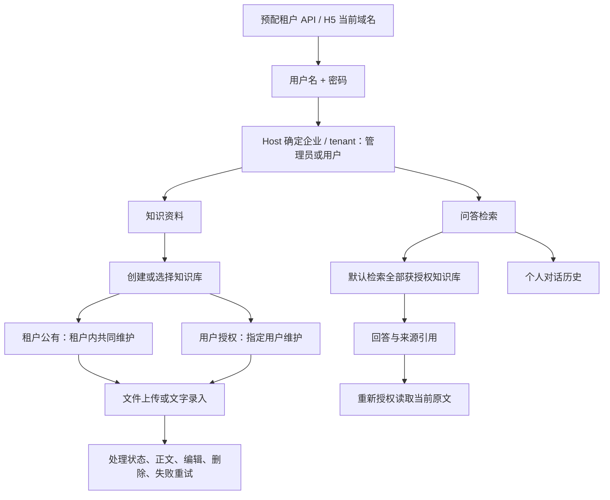

# 用户端 v1

用户端提供知识资料与问答检索两个入口，使用同一套服务端租户身份和知识库授权。

登录入口属于企业用户。每个租户的小程序预配置固定 API 地址，H5 可使用当前页面域名；服务端根据请求域名及受信代理信息确定企业，用户只提交用户名和密码。页面不提供企业地址输入或切换，本地旧地址缓存不能覆盖配置。会话绑定固定地址，配置变更后清理旧凭据；退出和 401 清理令牌与会话并取消未完成请求。配置缺失或无效时停止请求并提示联系管理员。密码不保存。平台身份独立管理，不进入用户端；旧会话缓存会要求重新登录，服务端用户 ID、资料及个人对话沿用。

知识库为独立资源，通过租户或用户授权决定读写权限，创建人只作审计记录。企业全员授权称为公有，指定用户授权称为私有。企业管理员不自动取得私有知识权限；顶级管理员可在网页管理端读取全部企业内容。跨企业分享的管理界面尚未实现。公有知识的读取、下载和检索直接按授权进行，创建、修改、删除及授权调整须管理员审批，冲突由管理员明确处理；私有知识可由获授权用户直接维护。文件与文字使用同样的授权规则，服务端验证每次列表、详情、修改、删除和来源读取请求。

问答不要求选择工作区。会话属于个人，不绑定知识库；每次默认检索当前用户全部获授权知识库。回答由实际模型生成，显示引用来源；没有依据时明确说明资料不足，服务失败时显示真实错误。

H5 和微信均读取 SSE，支持中文及 emoji 跨分块解码和单条停止。只有有效完成事件及传输结束后才显示正式回答，失败/取消清除预览；退出后迟到片段不会进入新会话。文件格式与大小上限读取服务端 `/file-types`。

H5 与微信小程序共用 Vue 组件和传输层，保留桌面侧栏、手机底栏与原有绿色视觉样式。API 客户端通过 Vue provide/inject 共享；组件属性只传递可序列化的数据。微信面板切换使用显式 display，避免 hidden 与 flex 样式冲突。

企业管理员在网页企业后台管理企业用户，顶级管理员维护模型与连接；顶级管理员在独立网页平台端管理企业。用户端不提供平台入口。小程序支持当前企业的账号密码登录和开放注册，注册后普通用户直接生效，恢复码仅在成功时提示保存；微信授权登录尚未接通。构建和验证方式见 [README](../README.md)。
