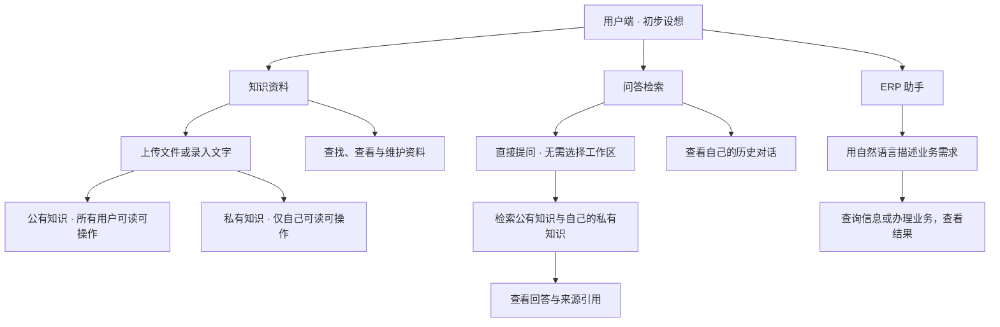

# 用户端初步设想与 Mock 原型说明

本文记录当前讨论阶段对用户端的初步设想，以及 uni-app Mock 原型用于核对这些设想的交互。用户端方案尚未定稿，本文不作为完整产品架构、最终需求或服务端技术方案。

当前先围绕知识资料、问答检索、ERP 助手三个入口核对页面和操作体验。用户管理、模型与 API 配置等属于后台，暂不展开；是否基于 AnythingLLM 二开也尚未决定。

## 用户端入口与交互设想

下图只表示用户可以从哪里进入、预期可以做什么，不表示服务划分、接口或数据存储架构。

### 知识资料

用户可以上传资料，也可以用文字记录规则或工作经验，并选择存入公有或私有知识。公私范围与内容分类分别展示：前者决定谁能使用和维护，后者帮助整理和查找资料。

目前原型提供“全部 / 公有知识 / 我的私有”切换、分类筛选、搜索、详情、编辑和删除。新增资料默认选择私有，也可主动选择公有。文字资料可以修改标题和正文；文件当前仅能修改名称。删除公有资料时，页面提示这一操作会影响所有用户。

### 问答检索

用户进入后直接提问，无需创建或加入 Workspace。原型默认范围为 `公有知识 ∪ 当前用户的私有知识`，也可以收窄为“仅公有”或“仅我的私有”。回答展示本次检索范围和来源引用，用户可以查看仍可访问的来源正文。

原型中的聊天历史按用户独立保存，引用同一份公有资料不会使整段聊天共享。切换演示身份后，只显示该身份自己的资料范围和对话。

### ERP 助手

初步设想是用户描述业务需求，由 AI 理解后通过 ERP MCP 完成相应查询或操作，并向用户展示结果。

目前原型用库存查询、订单查询和创建销售订单演示这一体验。创建销售订单包含信息补全、核对与确认步骤。具体支持哪些 ERP 业务、沿用哪些 ERP 权限、是否需要额外确认或审批，仍需后续明确；这些演示步骤不代表最终业务规则。

## 当前讨论采用的公私规则

| 范围 | 读取、检索与维护 |
| --- | --- |
| 公有知识 | 所有登录用户均可查看、检索、上传、修改和删除，包含维护他人上传的资料 |
| 私有知识 | 仅所属用户本人可查看、检索、上传、修改和删除，管理员也没有读取他人私有知识的例外 |

当前原型将“公有”演示为平台内登录用户共享。正式产品的用户组织范围与账号体系尚未在本文设计；公有范围如有进一步定义，应再同步调整原型。

知识可读可操作不意味着获得相应 ERP 业务权限。例如能查看采购流程，不能据此认定可以创建采购单。这里仅说明用户端体验应区分这两件事，具体授权方案另行设计。

## 原型选择与待核对事项

“产品资料 / 业务流程 / 人事制度 / 个人笔记”等分类、三个演示账号、默认新增为私有、检索范围切换、ERP 示例业务和页面布局，均用于当前阶段体验与讨论，后续可以调整。当前编辑没有提供公私转换、修改所属分类或替换文件内容，最终是否支持这些操作也尚未确定。

原型中的知识资料按 `libraryId` 归属知识库，知识库带有 `scope` 和 `ownerId`；上传人和最近修改人分别记录。这是当前 Mock 数据的组织方式，不代表最终数据模型已经确定。

后续需要继续核对资料维护范围、分类方式、文件处理状态、对话管理方式及 ERP 支持的业务和交互。后台管理、模型连接、服务端划分、检索和存储方案、AnythingLLM 复用范围不在本轮用户端设想中定稿。

## 当前 Mock 的能力边界

- 使用林晓、陈亦、周宁三个演示身份；切换身份用于核对公私资料和个人对话的展示，不是真实登录。
- 新选择的文件仅记录名称、大小及分类，不上传、不解析；文字录入可以在本地保存和编辑。
- 问答使用本地关键词匹配和模拟逐字输出，没有调用 LLM、Embedding 或向量数据库；示例文件中的正文为预置演示内容。
- 来源引用可以查看当前正文；来源已删除或当前身份无权访问时，不能打开。
- ERP 操作全部模拟，返回的 DEMO 编号和结果不表示真实业务已执行，也未连接 MCP 服务。
- 资料、演示身份和个人会话保存于 `enterprise-ai-preview-v2`；旧 `enterprise-ai-preview-v1` 不自动迁移。ERP 临时结果在刷新或切换身份后重置。
- 所有演示身份的数据保存在同一客户端；页面和本地函数过滤不构成生产环境的安全隔离。真实权限需要后续由服务端落实。

运行及验证命令见 [README](../README.md)。构建通过只说明原型可编译，不代表真实 RAG、ERP 或小程序真机验证已完成。
